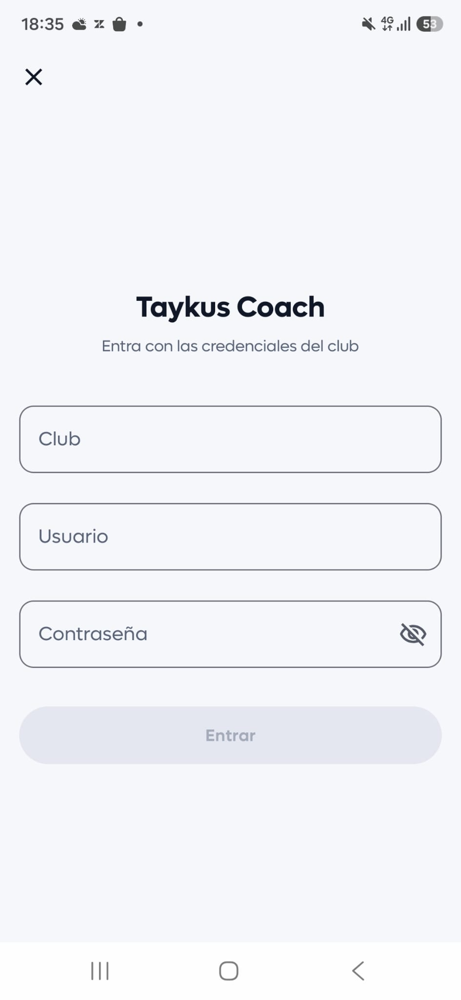
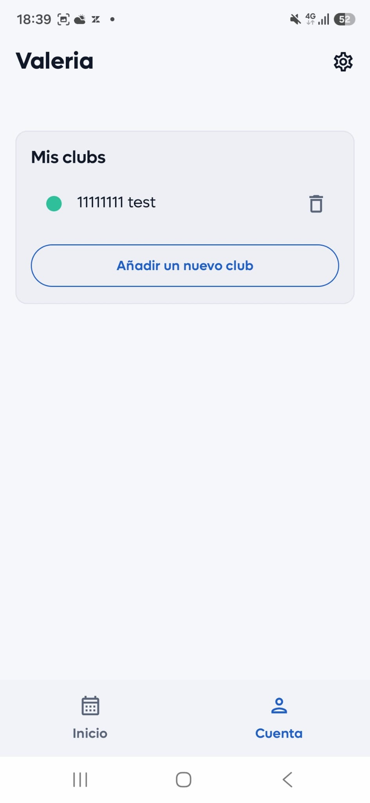

# Cómo entrar en Taykus Coach

Para entrar en Taykus Coach necesitas los datos de acceso que te da tu club: son los mismos con los que entras en la dirección web de profesores. Si das clase en varios clubs, añade cada uno con sus propios datos.

A continuación, se detallan los pasos a seguir:



### Descargar la app

* Descarga **Taykus Coach** desde la [App Store](https://apps.apple.com/es/app/taykus-coach/id6804599678) (iPhone y iPad) o desde [Google Play](https://play.google.com/store/apps/details?id=com.taykus.coach) (Android).



### Escribir los datos de acceso

* **Club:** el nombre de tu club.
* **Usuario:** tu email.
* **Contraseña:** la que te ha dado el club.
*   Clica en **Entrar**.

    
<figure><figcaption></figcaption></figure>




### Añadir otro club

* En la parte de abajo, clica en **Cuenta**.
* En **Mis clubs**, clica en **Añadir un nuevo club**.
* Escribe los datos de acceso de ese club y clica en **Entrar**.
*   Para quitar un club de la app, clica en el icono de la papelera que hay a su lado.

    
<figure><figcaption></figcaption></figure>




> **Importante:** si no puedes entrar, pide al club que revise que tienes creado tu usuario y tu recurso de profesor, y que están relacionados en Configuración › Academias.
