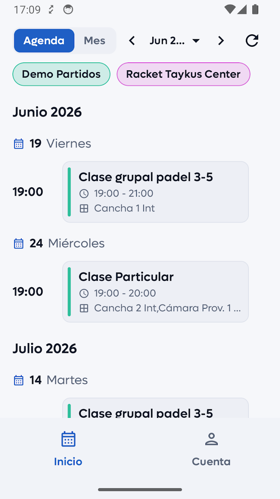
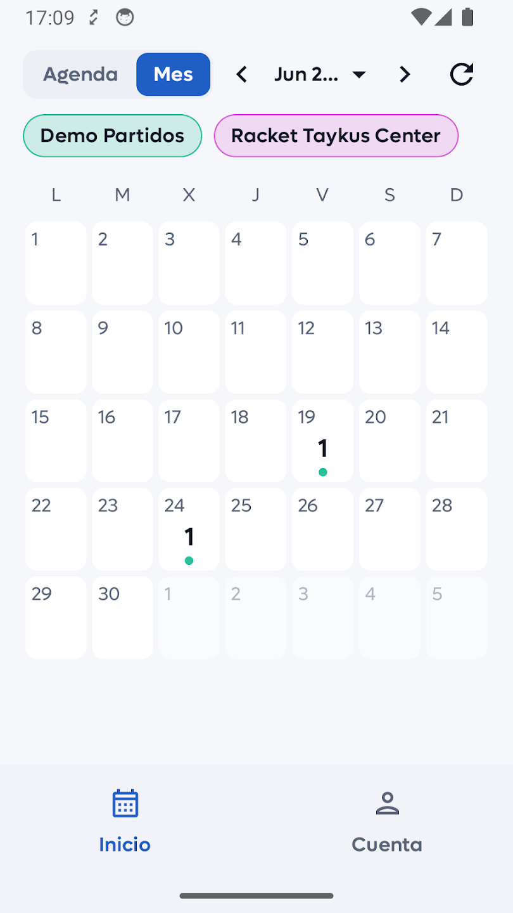

# Cómo ver tus clases en Taykus Coach

Al entrar en Taykus Coach verás tu calendario con las clases de todos tus clubs. Puedes verlo como una lista (Agenda) o como un mes completo (Mes), igual que en el calendario del móvil.

A continuación, se detallan los pasos a seguir:



### Vista Agenda

* En la parte de abajo, clica en **Inicio**.
* Arriba, selecciona **Agenda**.
*   Verás tus clases ordenadas por día, con el nombre de la clase, el horario y la pista.

    
<figure><figcaption></figcaption></figure>




### Vista Mes

* Selecciona **Mes**.
* Cada día muestra cuántas clases tienes, con un punto del color del club.
*   Clica en un día para ver sus clases.

    
<figure><figcaption></figcaption></figure>




### Cambiar de mes y actualizar

* Usa las flechas **‹** y **›** para ir al mes anterior o al siguiente, o clica en el mes para elegirlo.
* Clica en el icono de actualizar (la flecha circular) para cargar los últimos cambios del club.



### Elegir qué clubs ver

* Debajo de Agenda y Mes, cada club tiene su botón con su color.
* Clica en un club para seleccionarlo o quitarlo. Verás las clases de los clubs que tengas seleccionados.


