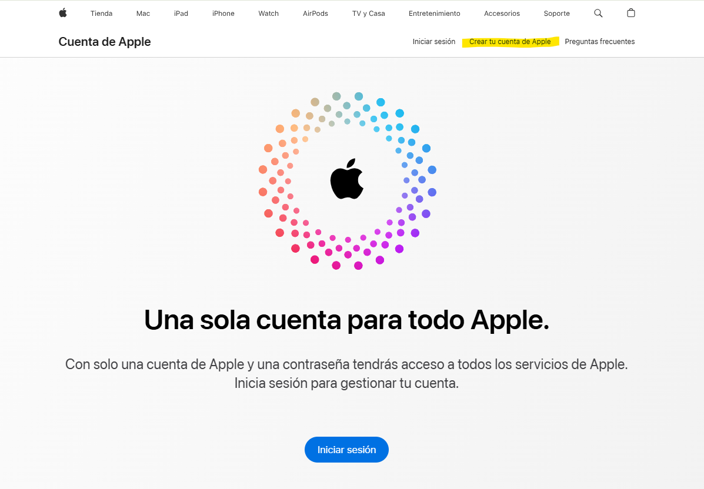
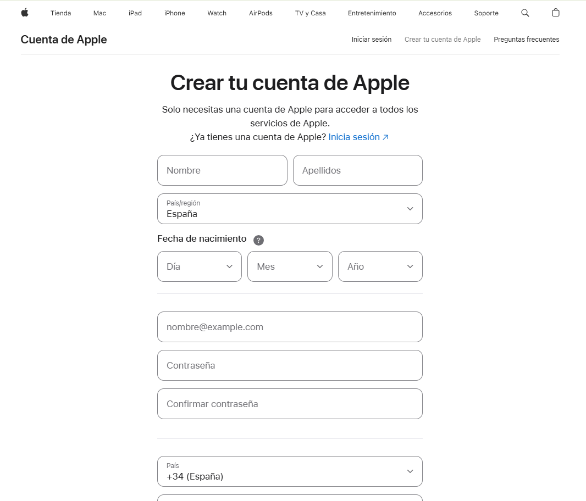
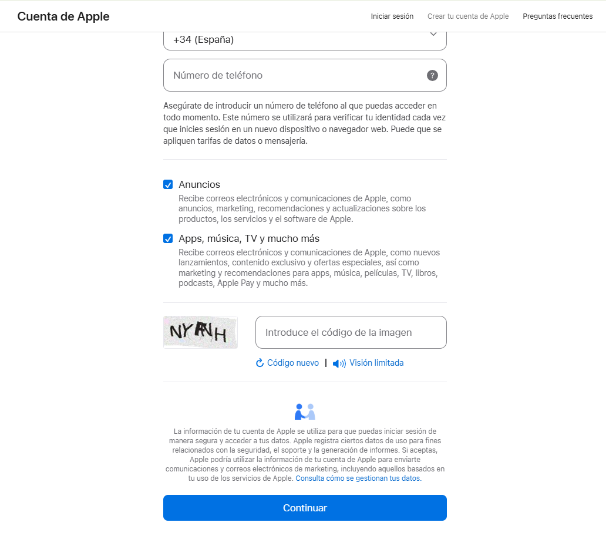
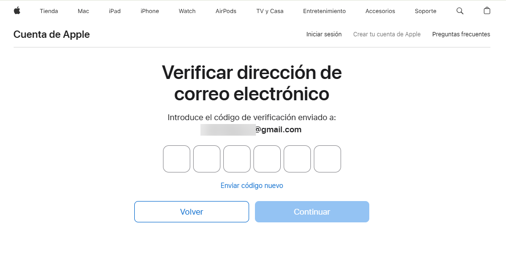
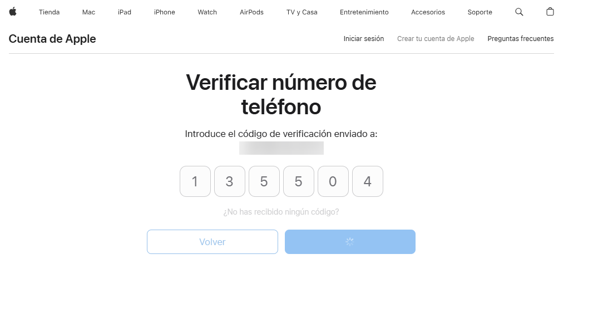
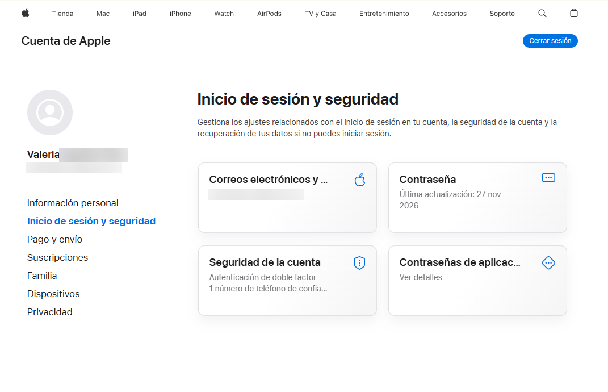

# Cómo crear una cuenta de Apple

La cuenta de Apple es lo primero que necesitas, tengas o no el número D-U-N-S: con ella se busca o se pide el número D-U-N-S y después se crea la cuenta de desarrollador.

> **Importante:** crea la cuenta a nombre de la persona que va a hacer el alta de la empresa, que tiene que tener autoridad para firmar en su nombre. Usa su nombre y apellidos reales (no el nombre del club). Usa el correo de la empresa (por ejemplo, nombre@tuclub.com). Si Apple no te deja crear la cuenta con él, por ejemplo porque ese correo ya tiene una cuenta de Apple, usa otro correo (por ejemplo, de Gmail).

A continuación, se detallan los pasos a seguir:



### Acceder a la web de Apple

* Accede a la web de cuentas de Apple desde el siguiente enlace:\
  <a href="https://account.apple.com/" class="button primary">Ir a Cuenta de Apple</a>
*   Arriba a la derecha, clica en **Crear tu cuenta de Apple**. 

    <figure><figcaption></figcaption></figure>



### Rellenar los datos

*   Rellena el formulario **Crear tu cuenta de Apple**: 

    <figure><figcaption></figcaption></figure>

    * **Nombre** y **Apellidos:** los reales de la persona, tal como aparecen en su DNI o pasaporte.
    * **País/región.**
    * **Fecha de nacimiento.**
    * **Correo electrónico:** el de la empresa si puedes (si Apple no te deja, otro, por ejemplo de Gmail). Será el usuario de la cuenta.
    * **Contraseña** y **Confirmar contraseña.**
    * **País** (prefijo) y **Número de teléfono:** el móvil de la persona. Apple lo usará para verificar su identidad cada vez que inicie sesión en un dispositivo o navegador nuevo, así que tiene que tenerlo siempre a mano.
*   Las casillas **Anuncios** y **Apps, música, TV y mucho más** son para recibir publicidad de Apple. Puedes desmarcarlas. 

    <figure><figcaption></figcaption></figure>
* Escribe el código de la imagen y clica en **Continuar**.



### Verificar el correo

*   Apple envía un código de 6 cifras al correo. Escríbelo y clica en **Continuar**. 

    <figure><figcaption></figcaption></figure>



### Verificar el teléfono

*   Apple envía otro código de 6 cifras por SMS al teléfono. Escríbelo y clica en **Continuar**. 

    <figure><figcaption></figcaption></figure>



### Comprobar la verificación en dos pasos

*   La cuenta ya está creada y se abre **Inicio de sesión y seguridad**. En **Seguridad de la cuenta** comprueba que aparece **Autenticación de doble factor**. Apple la exige para crear la cuenta de desarrollador. 

    <figure><figcaption></figcaption></figure>



Con la cuenta de Apple creada, ya puedes buscar o pedir el número D-U-N-S:

[Cómo solicitar el número D-U-N-S](como-solicitar-el-numero-d-u-n-s.md)

[Requisitos para crear una cuenta de desarrollador](requisitos-para-crear-una-cuenta-de-desarrollador.md)
