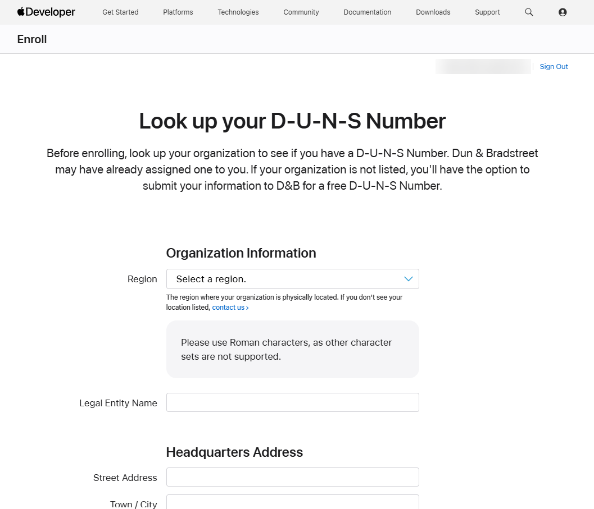
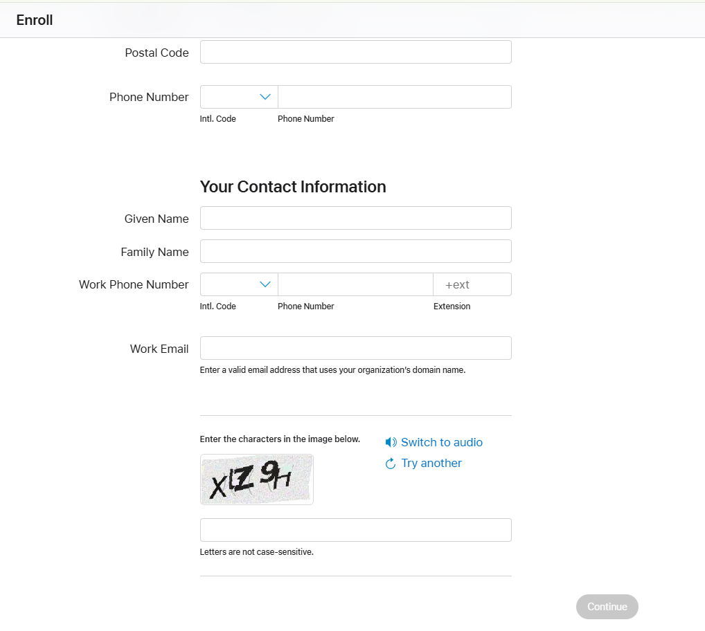
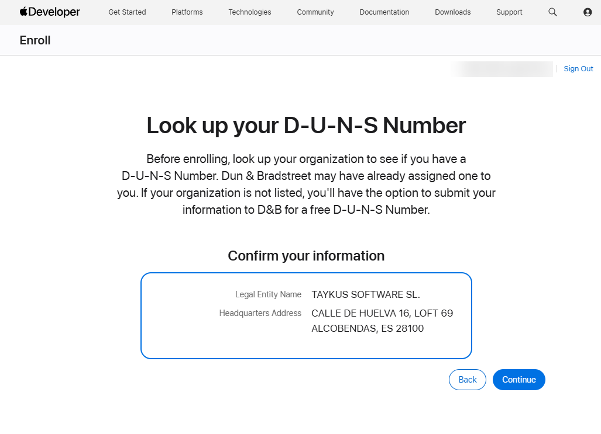
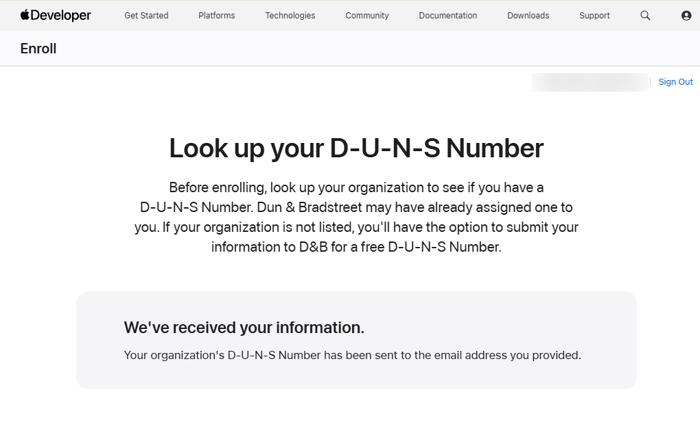
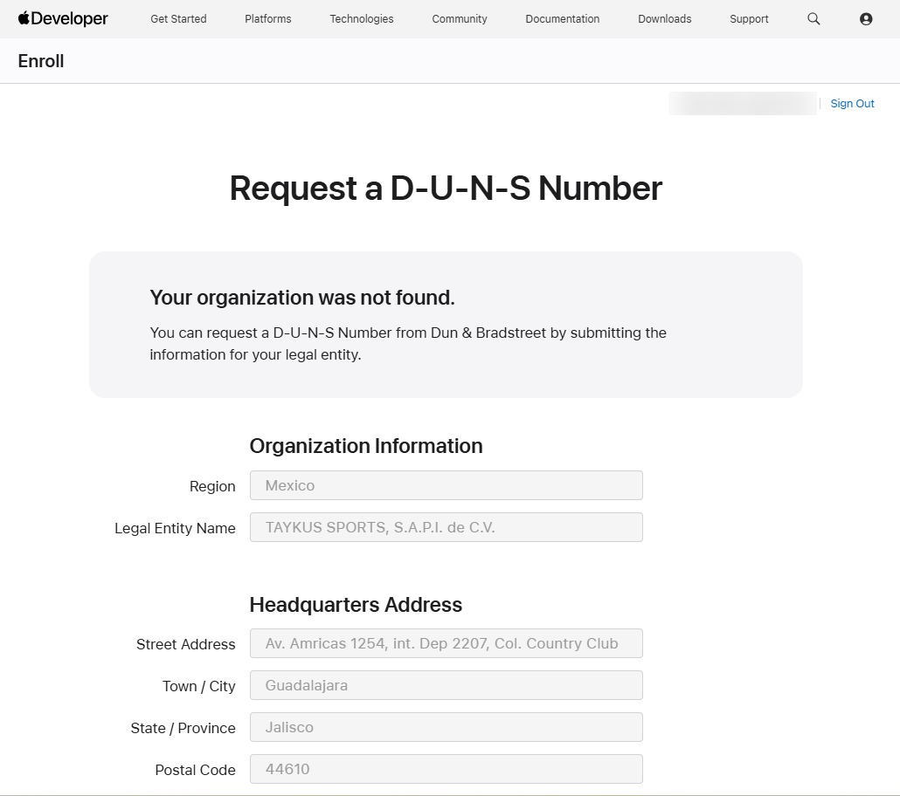
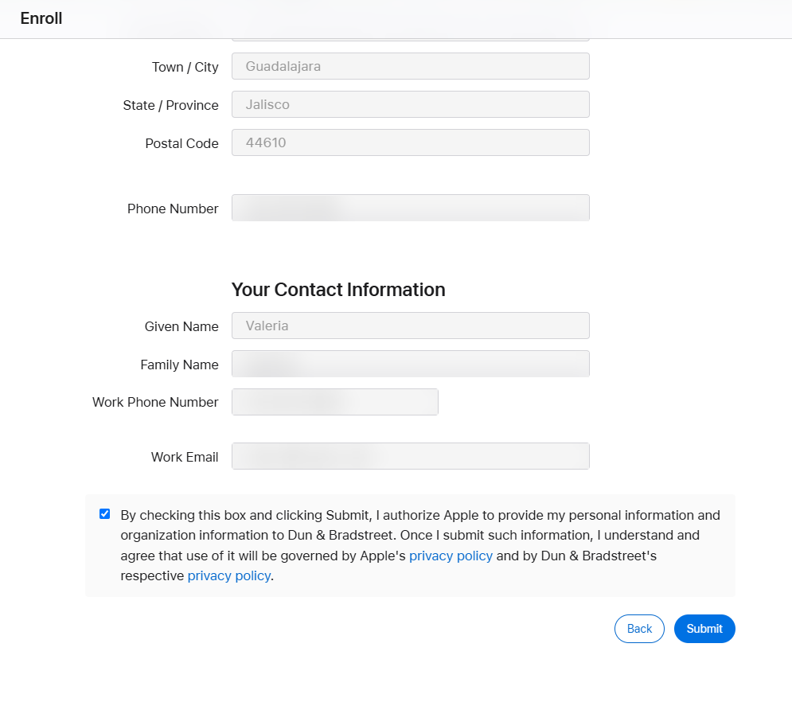
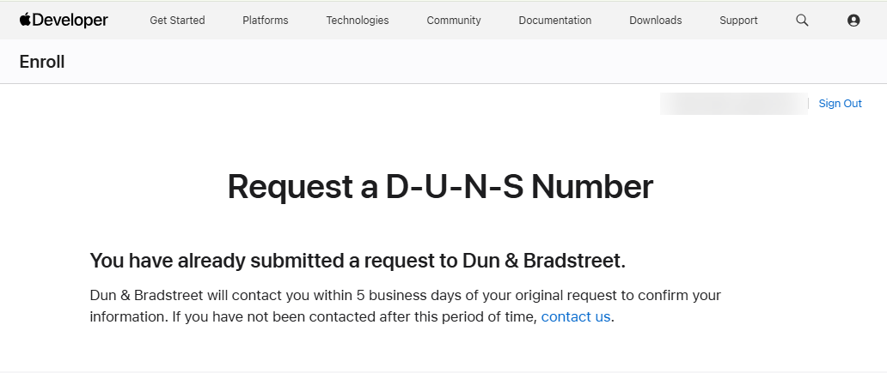

# Cómo solicitar el número D-U-N-S

La forma más sencilla de conseguir el número D-U-N-S es con la herramienta de Apple: ves al momento si la empresa ya tiene número y, si no lo tiene, puedes pedirlo gratis desde ahí mismo. El número sirve también para Google Play. Si no sabes qué es este número, consulta [Qué es el número D-U-N-S](que-es-el-numero-d-u-n-s.md).

A continuación, se detallan los pasos a seguir:



### Crear una cuenta de Apple

* Lo primero, tenga o no la empresa número D-U-N-S, es darte de alta en Apple: sin una cuenta de Apple no puedes usar la herramienta para buscarlo ni para pedirlo. Si todavía no tienes una, créala antes de empezar siguiendo [Cómo crear una cuenta de Apple](como-crear-una-cuenta-de-apple.md).
* Es la misma cuenta que usarás después para crear la cuenta de desarrollador.

  > **Importante:** la cuenta de Apple tiene que estar a nombre de una persona con autoridad para firmar en nombre de la empresa, con su nombre y apellidos reales (no el nombre del club). Usa el correo de la empresa (por ejemplo, nombre@tuclub.com). Si Apple no te deja crear la cuenta con él, por ejemplo porque ese correo ya tiene una cuenta de Apple, usa otro correo (por ejemplo, de Gmail). Activa también la verificación en dos pasos.



### Acceder a la herramienta de Apple

* Accede a la herramienta desde el siguiente enlace:\
  <a href="https://developer.apple.com/enroll/duns-lookup/" class="button primary">Buscar o solicitar el número D-U-N-S</a>
* Inicia sesión con tu cuenta de Apple. Se abre la página **Look up your D-U-N-S Number**.



### Rellenar los datos de la empresa

*   En **Organization Information**, elige el país en **Region** y escribe en **Legal Entity Name** el nombre legal de la empresa, exactamente como aparece en los registros oficiales. 

    <figure><figcaption></figcaption></figure>
* En **Headquarters Address**, rellena la dirección de la sede de la empresa y su teléfono.
*   En **Your Contact Information**, rellena tus datos de contacto. 

    <figure><figcaption></figcaption></figure>

    * **Work Email:** tiene que ser un correo con el dominio de la empresa (por ejemplo, nombre@tuclub.com). No vale un correo de Gmail, Hotmail o similar.
* Escribe los caracteres de la imagen y clica en **Continue**.

> **Importante:** tienes que rellenar todos los campos. Si falta alguno, la herramienta no te deja continuar.



### Comprobar el resultado



*   Aparece **Confirm your information** con el nombre legal y la dirección de la empresa. Comprueba que son correctos y clica en **Continue**. 

    <figure><figcaption></figcaption></figure>
*   Apple te envía al momento el número D-U-N-S al correo que has indicado. 

    <figure><figcaption></figcaption></figure>



*   Aparece **Your organization was not found** con los datos que has escrito. 

    <figure><figcaption></figcaption></figure>
*   Baja hasta el final de la página, marca la casilla de autorización y clica en **Submit**. 

    <figure><figcaption></figcaption></figure>
*   Aparece un mensaje que confirma que la solicitud se ha enviado. Es gratuita y Dun & Bradstreet se pondrá en contacto contigo en unos **5 días hábiles**. 

    <figure><figcaption></figcaption></figure>

> **Importante:** cuando recibas el número, Apple puede tardar hasta 2 días hábiles más en tenerlo registrado. Si al crear la cuenta de Apple te dice que no lo encuentra, espera esos días y vuelve a intentarlo, sin pedir un número nuevo.





### Si necesitas el número con urgencia

Si no puedes esperar, en España puedes pedirlo de pago a través de Informa y lo recibes de forma inmediata por **9 € + IVA**. En otros países el servicio y el importe son distintos: consulta la web de [Dun & Bradstreet](https://www.dnb.com/).

<a href="https://cloud.email.informa.es/numero-duns" class="button primary">Solicitar número D-U-N-S con Informa</a>

<figure><figcaption></figcaption></figure>

Cuando tengas el número D-U-N-S, sigue los pasos para crear la cuenta de desarrollador:

[Cómo crear una cuenta de desarrollador en Apple](apple/como-crear-una-cuenta-de-desarrollador.md)

[Cómo crear una cuenta de desarrollador en Google Play](google-play/como-crear-una-cuenta-de-desarrollador.md)
