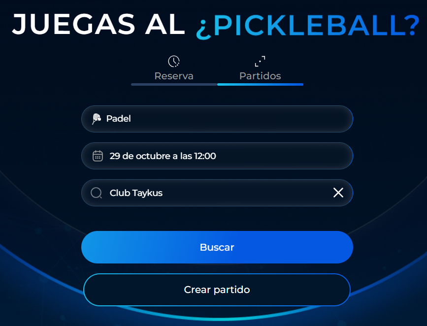
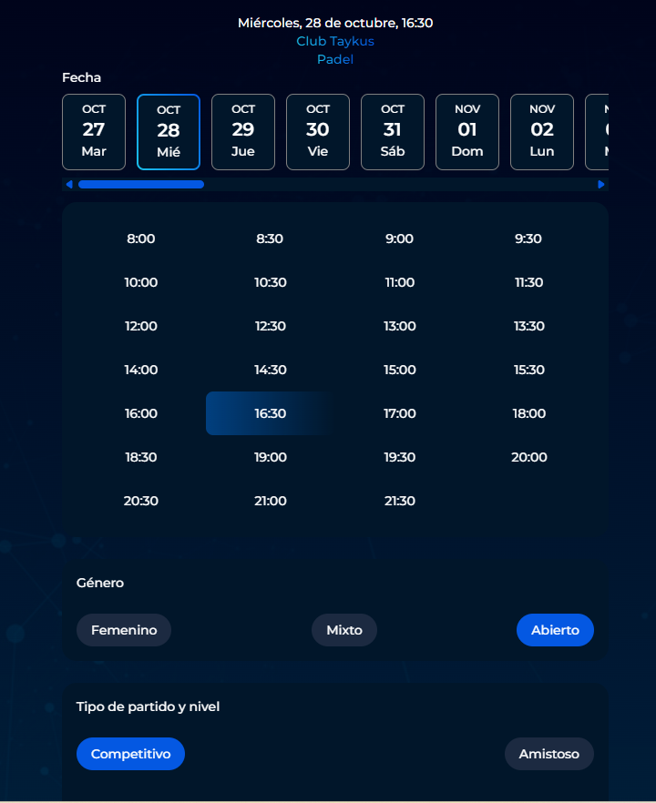
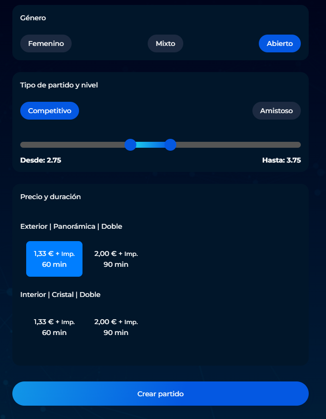

# Cómo crear un partido desde la app Taykus

Además de realizar reservas, la app Taykus permite a los jugadores crear partidos para que otros usuarios puedan apuntarse y completar el grupo de juego.

Esta opción resulta útil cuando el jugador quiere organizar un partido, pero aún no tiene todos los participantes confirmados. Desde la app podrá seleccionar el club, la fecha, la hora y las características de la pista, así como configurar los datos necesarios para publicar el partido.

### Vídeo explicativo



A continuación, se detallan los pasos a seguir:



### Elegir el club

* Entra en la pestaña **Partidos**.
* Comprueba el deporte y escribe el nombre de tu club en el buscador.
*   Clica en **Crear partido**.

    <figure><figcaption></figcaption></figure>



### Fecha y hora

* Elige el día en la barra de **Fecha**.
*   Selecciona la hora a la que quieres jugar.

    <figure><figcaption></figcaption></figure>



### Género, tipo de partido y nivel

<figure><figcaption></figcaption></figure>

* **Género:** te salen **Abierto**, **Mixto** y el de tu género (**Masculino** o **Femenino**).
* **Tipo de partido:** **Competitivo** (el resultado cambia tu nivel) o **Amistoso** (no lo cambia).
* **Nivel:** la barra sale con un rango alrededor de tu nivel. Mueve los dos puntos para elegir el nivel mínimo y máximo de los jugadores que pueden apuntarse.



### Precio y duración

* Elige las características de la pista (por ejemplo, Exterior, Panorámica, Doble) y la duración (por ejemplo, 60 o 90 minutos).
* El precio que ves es lo que paga cada jugador.

> No eliges una pista concreta: el partido se coloca en la pista virtual **Partidos** y, cuando se completa, pasa a una pista real libre. Para saber más, consulta [Cómo funcionan los partidos en el calendario](https://app.gitbook.com/s/hSQoRJmdDmzxYVh7vpFW/calendario/calendario/partidos/como-funcionan-los-partidos-en-el-calendario).



### Crear el partido

* Clica en **Crear partido**.



Para saber más sobre cada opción, consulta [Tipos de partido: competitivo, amistoso y género](https://app.gitbook.com/s/hSQoRJmdDmzxYVh7vpFW/calendario/calendario/partidos/tipos-de-partido).
