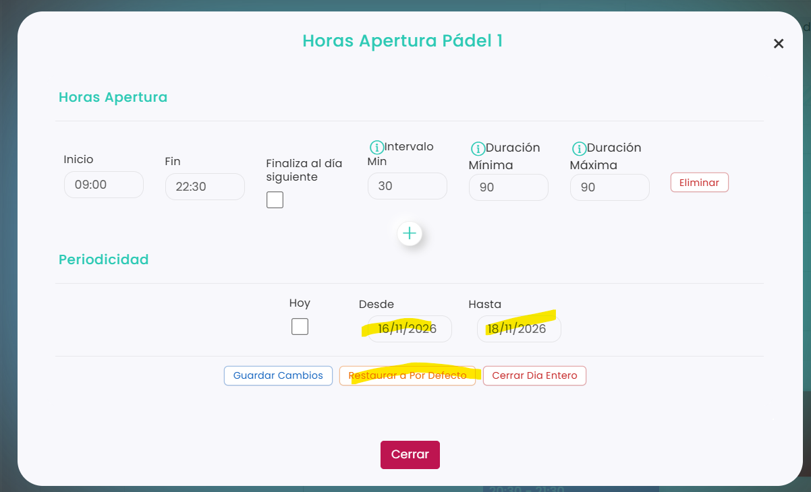

# Cómo abrir una pista

Si has cerrado una pista con **Cerrar Día Entero**, puedes volver a abrirla. Como la pista cerrada desaparece del calendario ese día, hay que hacerlo desde un día en el que sí aparezca, eligiendo un periodo que incluya el día cerrado.

Por ejemplo, si la pista está cerrada el día 17, entra en el calendario del día 16 y elige el periodo del 16 al 18.

A continuación, se detallan los pasos a seguir:



### Acceso a Calendario

*   Dirígete al menú lateral izquierdo y selecciona **Calendario**.

    <figure><figcaption></figcaption></figure>
*   Ve al día anterior al día en que la pista está cerrada. Puedes elegir el día en el calendario de arriba.

    <figure><figcaption></figcaption></figure>



### Abrir las horas de la pista

* Clica sobre el nombre de la pista. Se abre la ventana **Horas Apertura** de esa pista.



### Elegir el periodo

*   En **Periodicidad**, deja sin marcar **Hoy** y rellena las fechas:

    <figure><figcaption></figcaption></figure>

    * **Desde:** el día anterior al día cerrado.
    * **Hasta:** el día siguiente al día cerrado.



### Restaurar el horario

* Clica en **Restaurar a Por Defecto**.
* La pista vuelve a tener su horario normal y aparece de nuevo en el calendario.



> **Importante:** se abre solo la pista seleccionada. Si cerraste varias pistas ese día, repite el proceso con cada una de ellas.

Para saber cómo se cierra una pista, consulta [Cómo cerrar una pista](como-cerrar-una-pista.md).
