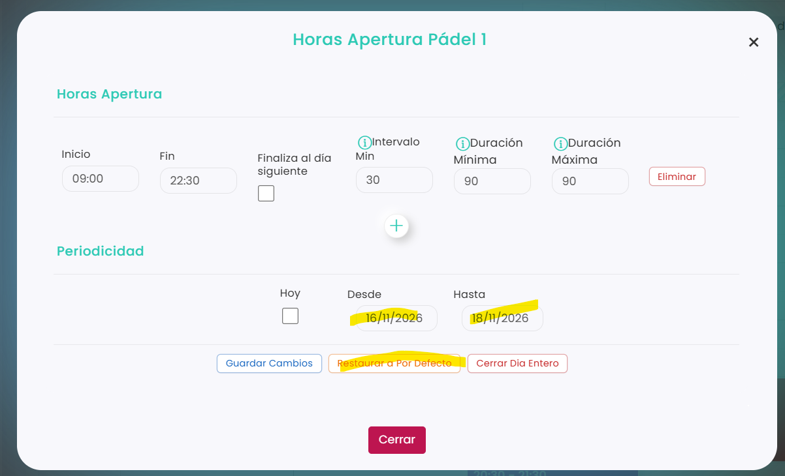

# Cómo abrir una pista

Si has cerrado una pista con **Cerrar Día Entero**, puedes volver a abrirla. Como la pista cerrada desaparece del calendario, hay que hacerlo desde un día en el que sí aparezca (el último día abierto antes del cierre o el primero después), eligiendo un periodo que incluya todos los días cerrados.

Por ejemplo:

* Si la pista está cerrada el día 17, entra en el calendario del día 16 (o del 18) y elige el periodo del 16 al 18.
* Si la pista está cerrada los días 16 y 17, el día 16 tampoco aparece. Entra en el calendario del día 15 (o del 18) y elige el periodo del 15 al 18.

A continuación, se detallan los pasos a seguir:



### Acceso a Calendario

*   Dirígete al menú lateral izquierdo y selecciona **Calendario**.

    <figure><figcaption></figcaption></figure>
*   Ve al día anterior o al siguiente al día en que la pista está cerrada. Puedes elegir el día en el calendario de arriba.

    <figure><figcaption></figcaption></figure>
*   Comprueba que la pista aparece ese día. Si no aparece, es que también está cerrada: sigue un día más atrás (o más adelante) hasta encontrar el primer día en el que la pista sí aparezca.



### Abrir las horas de la pista

* Clica sobre el nombre de la pista. Se abre la ventana **Horas Apertura** de esa pista.



### Elegir el periodo

*   En **Periodicidad**, deja sin marcar **Hoy** y rellena las fechas:

    <figure><figcaption></figcaption></figure>

    * **Desde:** el día anterior al primer día cerrado.
    * **Hasta:** el día siguiente al último día cerrado.

    > **Importante:** si la pista está cerrada varios días y solo quieres abrir el último, pon ese día en **Desde**. Por ejemplo, si está cerrada el 16 y el 17 y solo quieres abrir el 17, entra en el día 15 y elige el periodo del 17 al 18. Así el 16 sigue cerrado.



### Restaurar el horario

* Clica en **Restaurar a Por Defecto**.
* La pista vuelve a tener su horario normal y aparece de nuevo en el calendario.

> **Importante:** **Restaurar a Por Defecto** se aplica a todos los días del periodo. Si el día anterior o el siguiente tenían un horario especial, también vuelven a su horario normal. Revísalos después y, si hace falta, vuelve a ponerles su horario.



> **Importante:** se abre solo la pista seleccionada. Si cerraste varias pistas ese día, repite el proceso con cada una de ellas.

Para saber cómo se cierra una pista, consulta [Cómo cerrar una pista](como-cerrar-una-pista.md).
