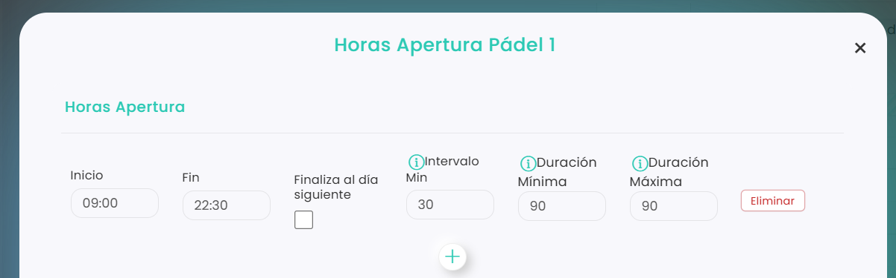

# Cómo cerrar una pista unas horas

Si solo necesitas cerrar una pista unas horas (por ejemplo, la mañana, la tarde o un rato en mitad del día), no hace falta cerrarla el día entero. Hay dos formas de hacerlo desde el calendario:

* **Cambiar sus horas de apertura** para ese día o esos días.
* **Bloquear esas horas con una reserva** sin jugadores.

> **Importante:** se hace pista por pista. Si necesitas cerrar varias pistas, repite el proceso con cada una.

## Opción 1: cambiar las horas de apertura

A continuación, se detallan los pasos a seguir:



### Acceso a Calendario

*   Dirígete al menú lateral izquierdo y selecciona **Calendario**.

    <figure><figcaption></figcaption></figure>
*   Ve al día que quieres cambiar. Puedes elegirlo en el calendario de arriba.

    <figure><figcaption></figcaption></figure>



### Abrir las horas de la pista

* Clica sobre el nombre de la pista. Se abre la ventana **Horas Apertura** de esa pista.



### Cambiar las horas

*   Cambia el **Inicio** y el **Fin** para dejar abiertas solo las horas que quieres.

    <figure><figcaption></figcaption></figure>

    * **Cerrar la tarde:** deja solo la mañana. Por ejemplo, de 09:00 a 14:00.
    * **Cerrar la mañana:** deja solo la tarde. Por ejemplo, de 16:00 a 22:30.
    * **Cerrar un rato en mitad del día:** crea dos tramos con **+**. Por ejemplo, uno de 09:00 a 14:00 y otro de 16:00 a 22:30, para cerrar de 14:00 a 16:00.



### Elegir los días y guardar

* En **Periodicidad**, marca **Hoy** si es solo para ese día, o rellena **Desde** y **Hasta** si son varios días seguidos.
* Clica en **Guardar Cambios**.



Para volver al horario normal, consulta [Cómo abrir una pista](como-abrir-una-pista.md).

## Opción 2: bloquear las horas con una reserva

También puedes crear una reserva en esa pista **sin añadir ningún jugador** y ajustarla a las horas que quieres cerrar. Así nadie puede reservar en ese hueco. Para saber cómo crear una reserva, consulta [Cómo crear una reserva](../reservas/como-crear-una-reserva.md).

> Si el cierre es para muchos días o para todo el club, es mejor cambiar el horario desde Configuración. Consulta [Cómo cerrar el club entre dos fechas](https://app.gitbook.com/s/V0h7jTfpeuZY1RmPEtNK/configuracion/reservas/horarios/como-cerrar-el-club-entre-dos-fechas).
