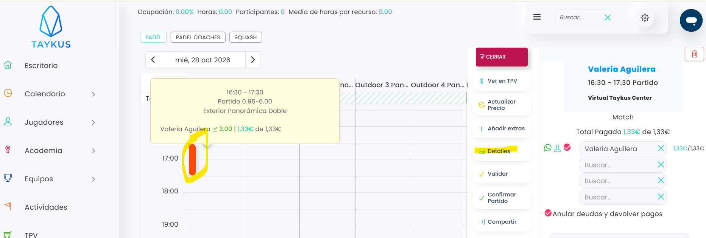
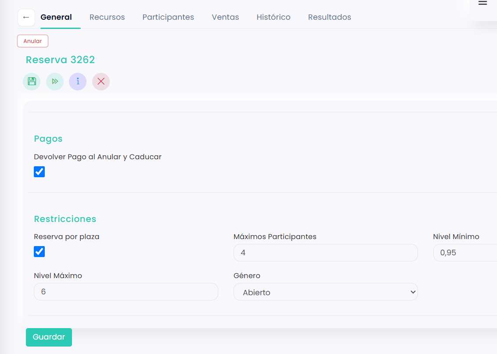

# Cómo cambiar el nivel de un partido

Una vez creado el partido, el club puede cambiar el nivel mínimo y máximo de los jugadores que pueden apuntarse. Los jugadores no pueden cambiarlo desde la app ni desde la zona de clientes.

A continuación, se detallan los pasos a seguir:



### Abrir el partido

* Dirígete al menú lateral izquierdo y selecciona **Calendario**.
* Clica sobre el partido.
*   En el menú de la derecha, clica en **Detalles**.

    <figure><figcaption></figcaption></figure>



### Cambiar el nivel

* Se abre la pestaña **General** de la reserva.
* Haz scroll hacia abajo hasta **Restricciones**.
*   Cambia el **Nivel Mínimo** y el **Nivel Máximo**.

    <figure><figcaption></figcaption></figure>



### Guardar

* Clica en **Guardar**.



Para saber más, consulta [Tipos de partido: competitivo, amistoso y género](tipos-de-partido.md).
