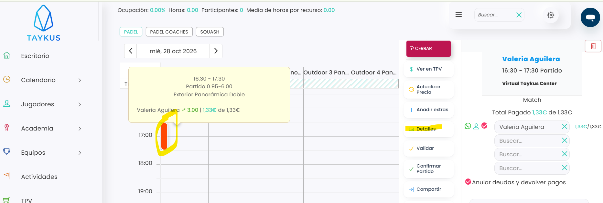
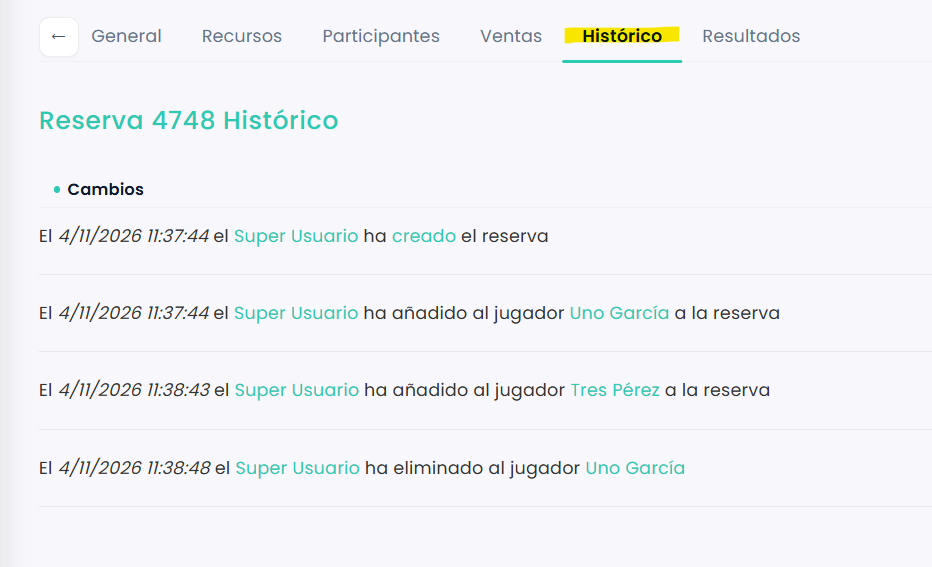

# Cómo ver el histórico de una reserva

En el histórico de una reserva ves todo lo que ha pasado con ella y quién lo ha hecho: quién la creó, quién la modificó, quién se apuntó, quién se salió o fue eliminado y quién la canceló.

> Los pagos de la reserva no aparecen en el histórico.

Puedes llegar al histórico desde el calendario o desde el listado de reservas.

## Desde el calendario

A continuación, se detallan los pasos a seguir:



### Abrir la reserva

*   Dirígete al menú lateral izquierdo y selecciona **Calendario**.

    <figure><figcaption></figcaption></figure>
* Clica sobre la reserva.
*   En el menú de la derecha, clica en **Detalles**.

    <figure><figcaption></figcaption></figure>



### Ver el histórico

*   Entra en la pestaña **Histórico**.

    <figure><figcaption></figcaption></figure>



## Desde el listado de reservas

Esta forma te sirve también para las reservas canceladas, que ya no salen en el calendario.



### Buscar la reserva

* Dirígete al menú lateral izquierdo, selecciona **Calendario** y, en el desplegable, elige **Reservas**.
* Localiza la reserva en el listado. Puedes usar los filtros de cada columna.



### Ver el histórico

* Clica en el **Id** de la reserva.
* Entra en la pestaña **Histórico**.



Para ver solo las reservas canceladas, consulta [Cómo ver las reservas canceladas](como-ver-las-reservas-canceladas.md).
