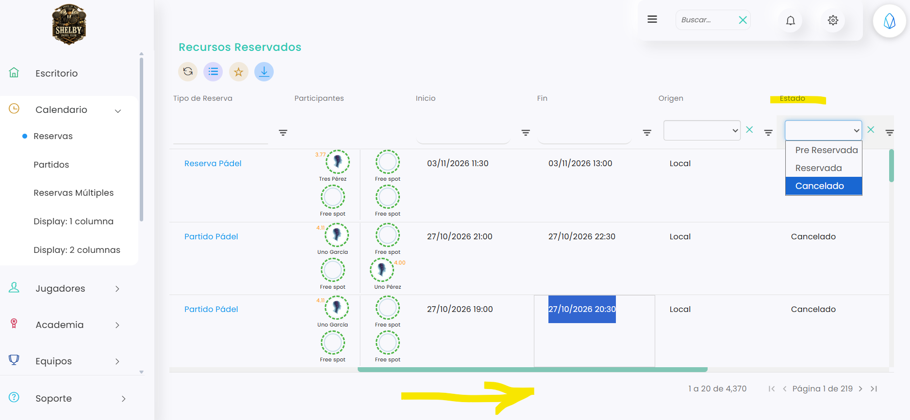

# Cómo ver las reservas canceladas

Las reservas canceladas ya no aparecen en el calendario, pero puedes verlas en el listado de reservas filtrando por su estado.

A continuación, se detallan los pasos a seguir:



### Acceso a Reservas

* Dirígete al menú lateral izquierdo y selecciona **Calendario**.
* En el desplegable, elige **Reservas**. Se abre el listado **Recursos Reservados**.



### Filtrar por canceladas

* Haz scroll hacia la derecha hasta la columna **Estado**.
*   En el filtro de esa columna, elige **Cancelado**.

    <figure><figcaption></figcaption></figure>
* El listado muestra solo las reservas canceladas.



Para saber quién canceló una reserva, clica en su **Id** y entra en la pestaña **Histórico**. Consulta [Cómo ver el histórico de una reserva](como-ver-el-historico-de-una-reserva.md).

Para no tener que poner el filtro cada vez, puedes guardar el listado como favorito. Consulta [Cómo guardar un listado como favorito](https://app.gitbook.com/s/V0h7jTfpeuZY1RmPEtNK/configuracion/listados/como-guardar-un-listado-como-favorito).
