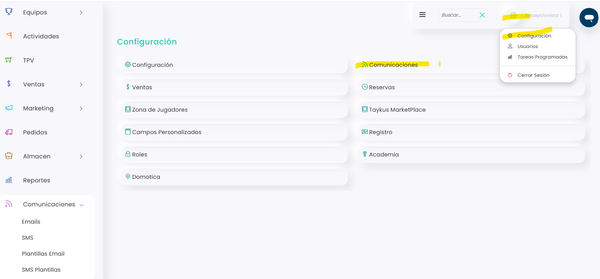

# Cómo configurar la cuenta de correo del club

Los correos automáticos del club (confirmaciones, facturas, recordatorios…) se envían desde la cuenta de correo configurada en Taykus. Puede ser la cuenta de Taykus o una cuenta propia del club, contratada con un proveedor de envío de correos como Mailjet u otro similar.

Lo recomendable es usar una cuenta propia: la de Taykus la comparten muchos clubes y algunos proveedores, como Gmail, pueden mandar sus correos a spam o bloquearlos. Para saber más, consulta [Uso de la cuenta de correo Taykus](uso-de-la-cuenta-de-correo-taykus.md).

> **Importante:** normalmente esta configuración la hace el equipo de Taykus. Si quieres cambiarla y tienes dudas, contacta con soporte.

A continuación, se detallan los pasos a seguir:



### Acceso a Comunicaciones

* Clica en el icono <i class="fa-gear" style="color:blue;">:gear:</i> de la esquina superior derecha y entra en **Configuración**.
*   Clica en **Comunicaciones**. Se abre la pestaña **Emails**.

    <figure><figcaption></figcaption></figure>



### Editar la cuenta

*   Clica en el icono <i class="fa-pen">:pen:</i>.

    <figure><figcaption></figcaption></figure>



### Datos de la cuenta

Escribe los datos que te haya dado tu proveedor de correo:

* **HOST**, **Puerto**, **Nombre de Usuario** y **Contraseña:** los datos de conexión con el servidor del proveedor.
* **Ssl** y **Tls:** el tipo de conexión segura que indique el proveedor.
* **Dirección de Remitente de Correo** y **Nombre de Remitente de Correo:** el correo y el nombre que verá el cliente cuando reciba un email del club. Usa datos que se reconozcan, por ejemplo el nombre del club y un correo corporativo, para que el cliente sepa que es un correo oficial.

> **Importante:** pon los datos tal y como te los da el proveedor. Si alguno no es correcto, los correos pueden no enviarse o ser rechazados.



### Guardar

* Clica en **Guardar**.



A partir de ese momento, Taykus enviará los correos automáticos del club desde esa cuenta.
