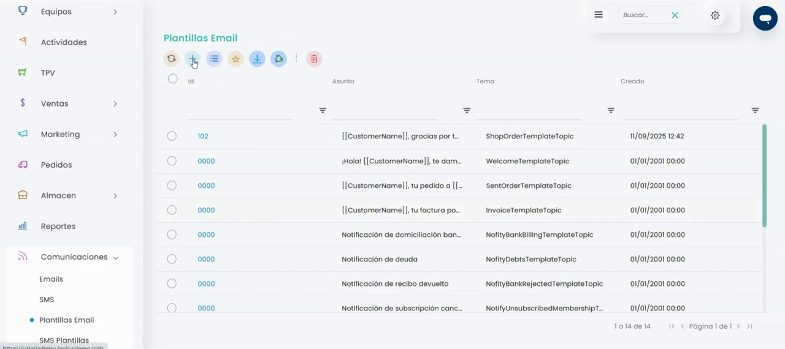
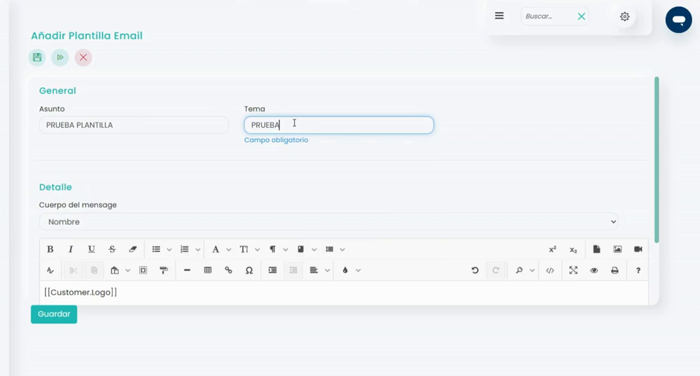
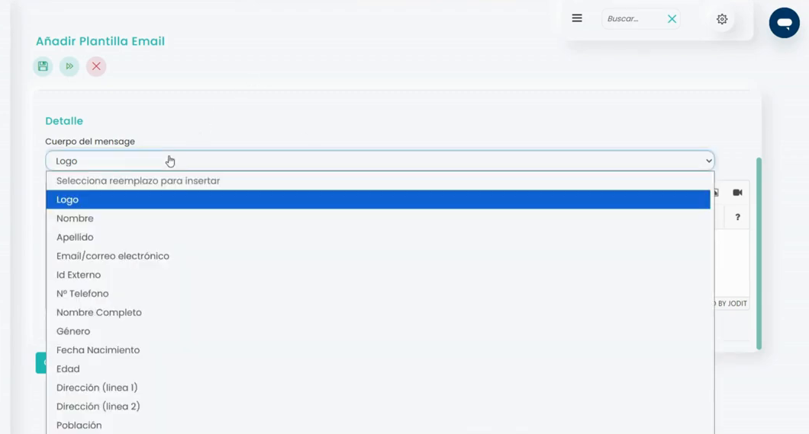
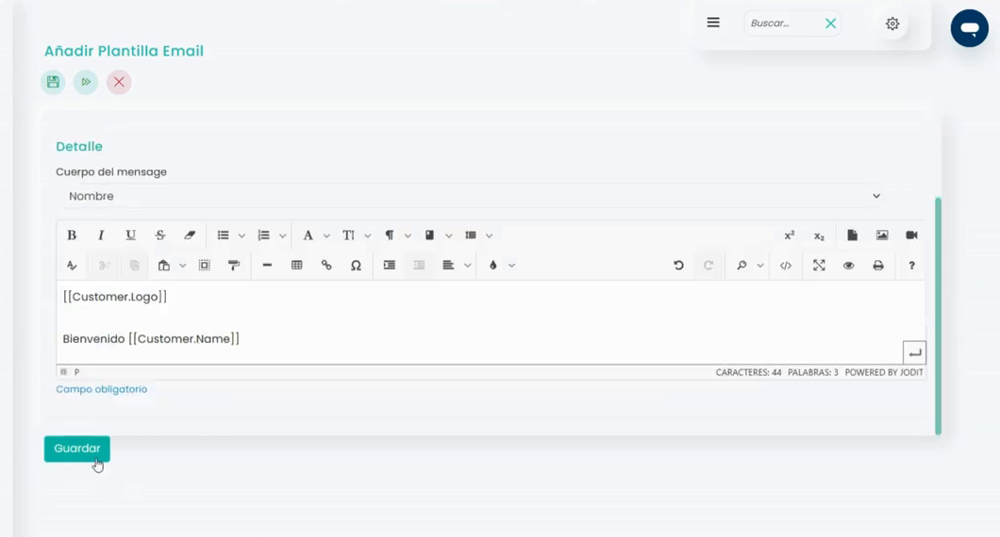
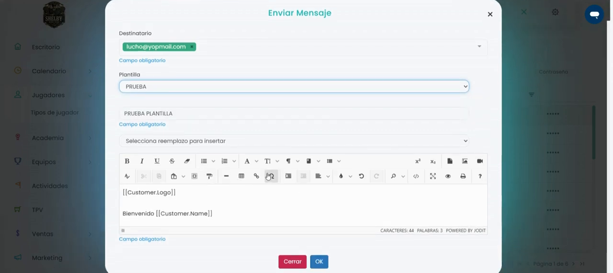

# Cómo crear una plantilla

Las plantillas de email sirven para guardar los correos que envías a menudo y no tener que escribirlos cada vez. Al enviar un correo a tus jugadores, eliges la plantilla y el asunto y el texto se rellenan solos.

### Vídeo explicativo



A continuación, se detallan los pasos a seguir:



### Acceso a Plantillas Email

* Dirígete al menú lateral izquierdo y selecciona **Comunicaciones**.
* En el desplegable, elige **Plantillas Email**.



### Crear la plantilla

*   Clica en :heavy\_plus\_sign:. Se abre la ventana **Añadir Plantilla Email**.

    <figure><figcaption></figcaption></figure>



### Asunto y tema

*   En el bloque **General**, rellena estos campos:

    <figure><figcaption></figcaption></figure>

    * **Asunto:** el asunto del correo, el que verá el cliente al recibirlo. Por ejemplo, _Bienvenido al club_.
    * **Tema:** el nombre de la plantilla. Escribe uno que la identifique: es el que verás en la lista cuando elijas la plantilla al enviar un correo. Campo obligatorio.



### Texto del correo

* En el bloque **Detalle**, escribe el texto en **Cuerpo del mensaje**. Puedes darle formato con la barra de herramientas (negrita, listas, colores, imágenes…).
*   Para añadir un dato del cliente, como su nombre, sitúa el cursor donde quieras que aparezca y elígelo en el desplegable **Selecciona reemplazo para insertar**.

    <figure><figcaption></figcaption></figure>
* Se añade una palabra entre dobles corchetes, por ejemplo `[[Customer.Name]]`. Al enviar el correo, se cambia por el dato de cada cliente.



### Guardar

*   Clica en **Guardar**. La plantilla aparecerá en el listado de **Plantillas Email**.

    <figure><figcaption></figcaption></figure>



## Usar la plantilla al enviar un correo

* Dirígete al menú lateral izquierdo, selecciona **Jugadores** y marca los jugadores a los que quieres enviar el correo.
* Clica en el icono del sobre y elige **Email**.
*   En **Plantilla**, elige la plantilla por su tema. El asunto y el texto se rellenan solos.

    <figure><figcaption></figcaption></figure>
* Revisa el correo, cambia lo que necesites y clica en **OK** para enviarlo.

Para añadir una imagen al correo, consulta [Cómo adjuntar una imagen a un mail](como-adjuntar-una-imagen-a-un-mail.md).
