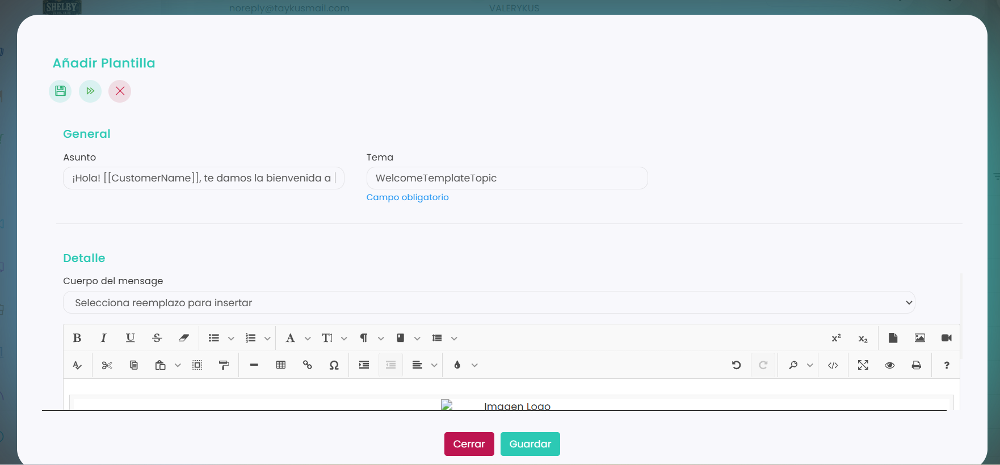

# Cómo editar una plantilla

Puedes cambiar cualquier plantilla de email, tanto las que ha creado el club como las automáticas de Taykus (bienvenida, facturas, notificaciones de deuda…). Los cambios se aplican a los correos que se envíen a partir de ese momento.

A continuación, se detallan los pasos a seguir:



### Acceso a Plantillas Email

* Dirígete al menú lateral izquierdo y selecciona **Comunicaciones**.
*   En el desplegable, elige **Plantillas Email**.

    <figure><figcaption></figcaption></figure>



### Abrir la plantilla

* Clica en el **Id** de la plantilla que quieres cambiar. Las automáticas tienen el Id **0000**.
* Se abre la plantilla, ya lista para editar.



### Cambiar la plantilla

*   Cambia lo que necesites: el **Asunto**, el **Tema** o el texto del **Cuerpo del mensaje**.

    <figure><figcaption></figcaption></figure>
* Para añadir un dato del cliente, elígelo en **Selecciona reemplazo para insertar**.

> **Importante:** las palabras entre dobles corchetes, como `[[CustomerName]]`, se cambian por los datos de cada cliente al enviar el correo. Si las borras, ese dato dejará de salir.



### Guardar

* Clica en **Guardar**.



Para crear una plantilla nueva, consulta [Cómo crear una plantilla](como-crear-una-plantilla.md).
