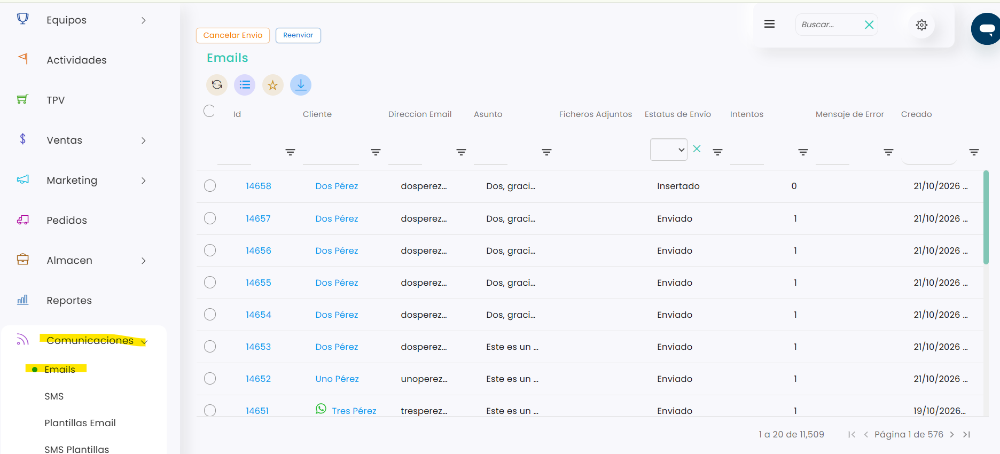
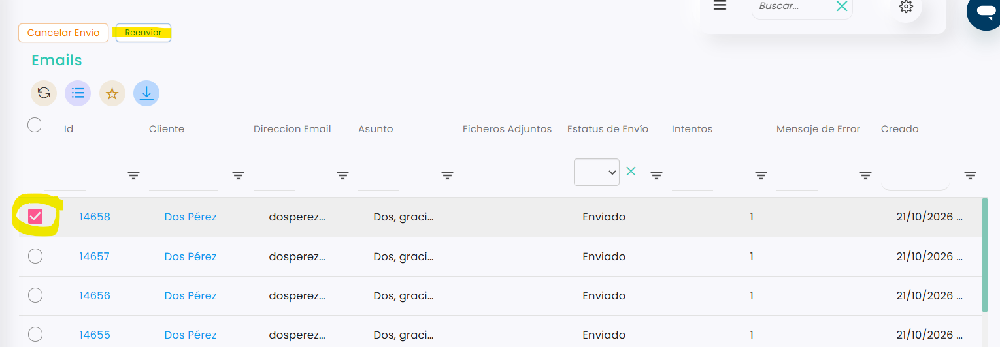
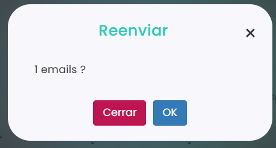

# Cómo reenviar un mail

Taykus permite volver a enviar cualquier correo que el sistema ya haya mandado a un cliente (confirmaciones de reserva, tickets, cuotas…). Es útil, por ejemplo, cuando el cliente dice que no lo ha recibido o lo ha borrado.

A continuación, se detallan los pasos a seguir:



### Acceso a los correos enviados

* Dirígete al menú lateral izquierdo y selecciona **Comunicaciones**.
*   En el desplegable, elige **Emails**. Verás el listado de correos enviados por el sistema. 

    <figure><figcaption></figcaption></figure>



### Seleccionar el correo

* Localiza el correo que quieres reenviar. Puedes usar los filtros de cada columna, por ejemplo **Cliente** o **Asunto**.
* Marca la casilla de la izquierda del correo. Si quieres reenviar varios a la vez, márcalos todos.
*   Clica en **Reenviar**, en la parte superior del listado. 

    <figure><figcaption></figcaption></figure>



### Confirmar el reenvío

*   Se abre una ventana que te pide confirmación:

    <figure><figcaption></figcaption></figure>
* Clica en **OK** para reenviarlo, o en **Cerrar** si no quieres reenviarlo.



### Comprobar el reenvío

* El correo vuelve a aparecer en el listado con el estado **Insertado** y **Intentos** a 0 mientras está pendiente de salir.
* Cuando sale de nuevo, su **Estatus de envío** cambia a **Enviado**.



> **Importante:** desde esta pantalla no se puede cambiar la dirección de correo. Si el cliente la tenía mal, corrígela primero en su ficha y después reenvía el correo: se enviará a la dirección nueva.

Para saber más sobre los estados de los correos, consulta [Dónde ver el estado de envío de los correos](donde-ver-el-estado-de-envio-de-los-correos.md).
