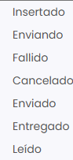

# Dónde ver el estado de envío de los correos

Taykus permite consultar el estado de los correos enviados a los clientes y revisar si el sistema ha procesado correctamente cada comunicación.

A continuación, se detallan los pasos a seguir:



### Acceso a los correos enviados

* Dirígete al menú lateral izquierdo y selecciona **Comunicaciones**.
* En el desplegable, elige **Emails**. Verás el listado de correos enviados por el sistema.



### Consultar el estado

* Localiza el correo que quieres revisar. Puedes usar los filtros de cada columna, por ejemplo **Cliente** o **Asunto**.
* Comprueba la columna **Estatus de envío**. Estos son los estados que verás:
  * **Insertado:** el correo se ha creado y está esperando a salir.
  * **Enviado:** el correo ha salido.
  * **Fallido:** el correo no se ha podido enviar. Taykus lo intenta hasta tres veces antes de marcarlo como fallido; la columna **Intentos** indica cuántas veces se ha intentado.
  * **Cancelado:** el envío se ha cancelado.

> En el filtro de la columna salen más estados (**Enviando**, **Entregado**, **Leído**), pero no se usan.

<figure><figcaption></figcaption></figure>



> **Importante:** el estado **Enviado** indica que el correo ha sido procesado por Taykus, pero no garantiza que el proveedor de correo del destinatario lo haya entregado en su bandeja de entrada.

Si un correo no le ha llegado al cliente, puedes volver a enviarlo. Consulta [Cómo reenviar un mail](como-reenviar-un-mail.md).
