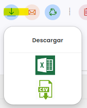

# Cómo exportar un listado

Puedes descargar cualquier listado para trabajar con él fuera de Taykus o guardarlo. Se exporta lo que ves en ese momento: los registros que cumplen tus filtros y las columnas que tienes visibles.

A continuación, se detallan los pasos a seguir:



### Filtrar el listado

* Aplica los filtros y deja visibles las columnas que quieres exportar. Consulta [Cómo ocultar o mostrar columnas](como-ocultar-o-mostrar-columnas.md).



### Exportar

* Clica en el icono de la flecha de descarga, encima del listado.
*   En **Descargar**, elige el formato: **Excel** o **CSV**. El archivo se descarga en tu ordenador.

    <figure><figcaption></figcaption></figure>


