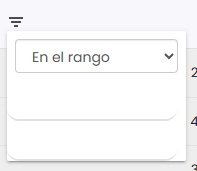
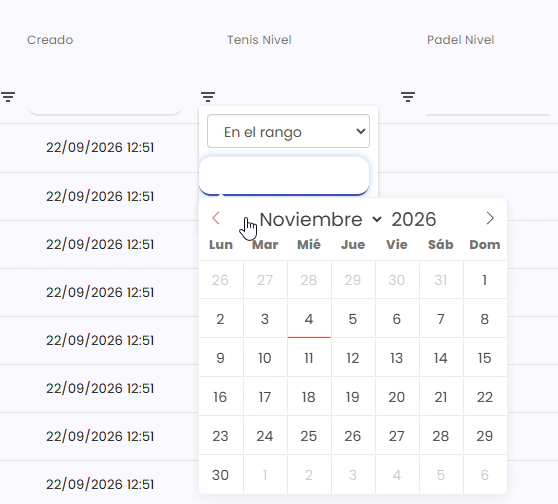
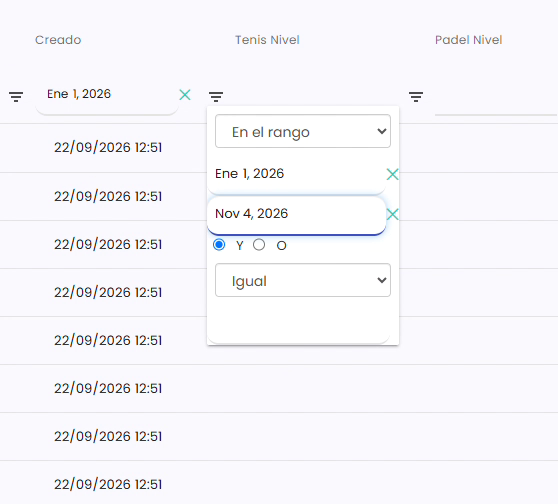

# Cómo filtrar entre dos fechas

En los listados puedes quedarte solo con los registros de un periodo, por ejemplo las ventas de un mes. Se hace con el filtro de la columna de fecha.

A continuación, se detallan los pasos a seguir:



### Abrir el filtro de la columna

* En la cabecera del listado, busca la columna de fecha por la que quieres filtrar (por ejemplo, **Creado** o **Fecha de emisión**).
* Clica en el icono de las tres rayitas de esa columna.

> Cada columna tiene su propio filtro, y las opciones cambian según lo que contenga: texto, números o fechas.



### Elegir En el rango

*   En el desplegable, elige **En el rango**. Salen dos campos: el primero para la fecha de inicio y el segundo para la de fin.

    <figure><figcaption></figcaption></figure>

    > También puedes usar **Menor que** (anteriores a una fecha), **Mayor que** (posteriores a una fecha) o **Igual** (un día concreto).



### Fecha de inicio

*   Clica en el primer campo y elige la fecha en el calendario. Puedes cambiar el mes y el año en la parte de arriba.

    <figure><figcaption></figcaption></figure>
* Al elegirla, el filtro se cierra.



### Fecha de fin

* Vuelve a clicar en el icono de las tres rayitas de la misma columna.
*   Clica en el segundo campo y elige la fecha de fin.

    <figure><figcaption></figcaption></figure>
* El listado muestra solo los registros entre esas dos fechas.



Para no tener que repetir el filtro cada vez, puedes guardar el listado como favorito. Consulta [Cómo guardar un listado como favorito](como-guardar-un-listado-como-favorito.md).
