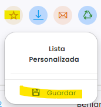
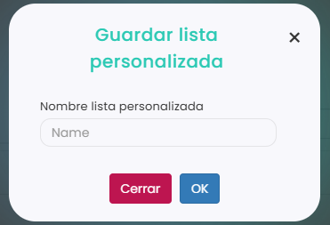
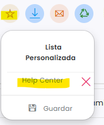

# Cómo guardar un listado como favorito

Si consultas a menudo un listado con los mismos filtros y columnas, guárdalo como favorito. En el panel se llama **Lista Personalizada** y guarda todo: los filtros, las columnas que se ven y su orden.

> **Importante:** las listas personalizadas las puede abrir cualquier usuario del club, no solo quien las crea.

A continuación, se detallan los pasos a seguir:



### Preparar el listado

* Aplica los filtros y deja las columnas como las quieres. Consulta [Cómo filtrar entre dos fechas](como-filtrar-entre-dos-fechas.md), [Cómo mover columnas](como-mover-columnas.md) y [Cómo ocultar o mostrar columnas](como-ocultar-o-mostrar-columnas.md).



### Guardar la lista

*   Clica en el icono de la estrella, encima del listado, y después en **Guardar**.

    <figure><figcaption></figcaption></figure>
*   Escribe un nombre en **Nombre lista personalizada** y clica en **OK**.

    <figure><figcaption></figcaption></figure>



### Abrir una lista guardada

*   Clica en el icono de la estrella. Las listas guardadas salen debajo de **Lista Personalizada**.
*   Clica en el nombre de la lista para abrirla.

    <figure><figcaption></figcaption></figure>


