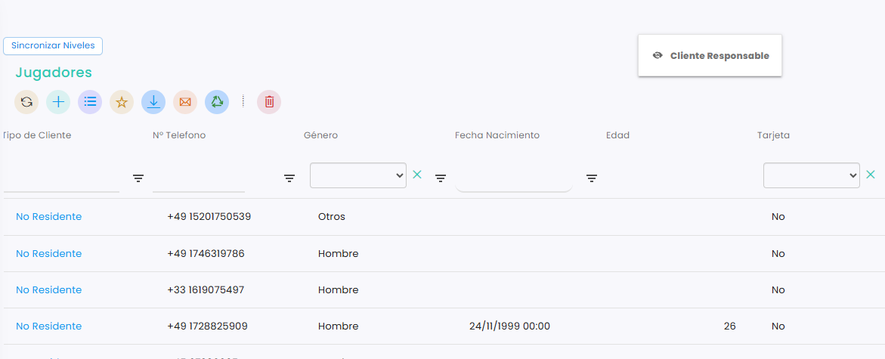
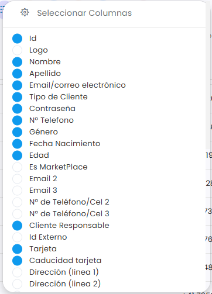

# Cómo ocultar o mostrar columnas

Puedes ocultar las columnas que no necesitas para ver el listado más limpio, y volver a mostrarlas cuando quieras. También puedes mostrar columnas que no salen de inicio.

> Las columnas no se borran: solo se ocultan, y siempre puedes recuperarlas.

## Ocultar una columna arrastrándola

*   Clica en la cabecera de la columna y, sin soltar, arrástrala hacia arriba, fuera del listado. Cuando sale el icono del ojo junto a su nombre, suéltala: la columna desaparece.

    <figure><figcaption></figcaption></figure>

## Ocultar o mostrar columnas desde el botón de columnas

A continuación, se detallan los pasos a seguir:



### Abrir la lista de columnas

*   En los botones de encima del listado, junto a :heavy\_plus\_sign:, clica en el icono de las rayitas.

    <figure><figcaption></figcaption></figure>
* Se abre **Seleccionar Columnas**, con todas las columnas que puede tener el listado. Si no ves la que buscas, haz scroll hacia abajo.



### Elegir las columnas

*   Las columnas con el círculo en azul son las que se ven. Clica en el círculo para mostrar u ocultar cada una.

    <figure><figcaption></figcaption></figure>
* Desde aquí puedes recuperar una columna que hayas ocultado sin querer, o añadir una que no aparece de inicio.



Para conservar las columnas elegidas, guarda el listado como favorito. Consulta [Cómo guardar un listado como favorito](como-guardar-un-listado-como-favorito.md).
