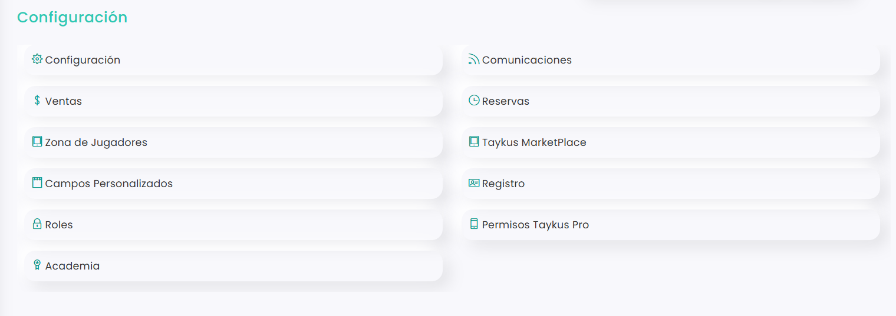
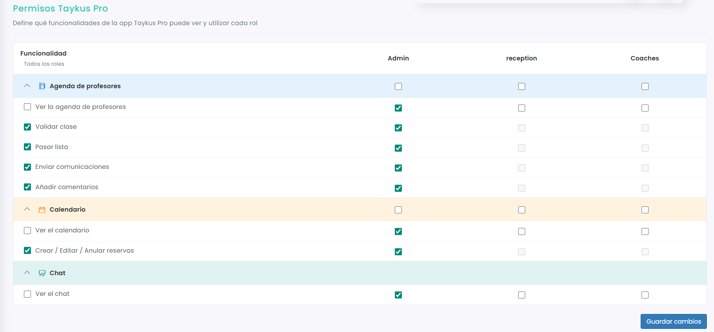

# Cómo dar permisos en Taykus Pro

En **Permisos Taykus Pro** decides qué puede ver y hacer cada rol del club en la app Taykus Pro. Los roles son los mismos que tienes en **Configuración › Roles**.

A continuación, se detallan los pasos a seguir:



### Acceso a Permisos Taykus Pro

* Clica en el icono <i class="fa-gear" style="color:blue;">:gear:</i> de la esquina superior derecha y entra en **Configuración**.
*   Clica en **Permisos Taykus Pro**.

    <figure><figcaption></figcaption></figure>



### Marcar los permisos de cada rol

* Cada fila es una funcionalidad de la app y cada columna, un rol del club.
*   Marca la casilla del rol en cada funcionalidad que quieras darle:

    <figure><figcaption></figcaption></figure>

    * **Agenda de profesores:** **Ver la agenda de profesores** (cada uno ve su propia agenda de clases), **Validar clase**, **Pasar lista**, **Enviar comunicaciones** y **Añadir comentarios**.
    * **Calendario:** **Ver el calendario** y **Crear / Editar / Anular reservas**.
    * **Chat:** **Ver el chat**.
* La casilla de la fila de cada bloque (por ejemplo, **Calendario**) marca todo el bloque para ese rol.
* La casilla de la izquierda de cada funcionalidad (columna **Todos los roles**) la marca para todos los roles.
* Lo que un rol no tiene permitido no le sale en el menú de la app.

> **Importante:** para dar un permiso como **Validar clase** o **Crear / Editar / Anular reservas**, primero marca el permiso de ver de su bloque. Hasta entonces, su casilla sale en gris.



### Guardar

* Clica en **Guardar cambios**.


