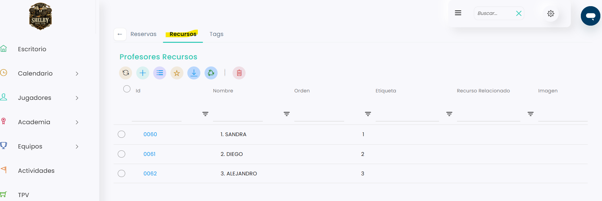
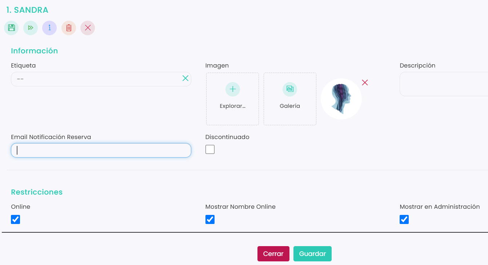

# Cómo avisar por email a un profesor cuando tiene una reserva

Si quieres que un profesor reciba un correo cada vez que alguien reserva o cancela una clase con él, escribe su correo en el campo **Email Notificación Reserva** de su ficha. El aviso llega con cualquier reserva en la que esté ese profesor, sea del tipo que sea.

> **Importante:** el correo se pone profesor por profesor, y cada profesor admite un solo correo.

A continuación, se detallan los pasos a seguir:



### Acceso a Grupo de recursos

* Clica en el icono <i class="fa-gear" style="color:blue;">:gear:</i> de la esquina superior derecha y entra en **Configuración**.
*   Clica en **Reservas**.

    <figure><figcaption></figcaption></figure>
*   Se abrirá directamente el bloque **Grupos de Recursos**. Clica en el **Id** de **Profesores**.

    <figure><figcaption></figcaption></figure>



### Abrir el listado de profesores

*   Entra en la pestaña **Recursos**. Verás todos los profesores del club.

    <figure><figcaption></figcaption></figure>



### Añadir el correo

Puedes hacerlo de dos formas:

**Desde el listado (la más rápida)**

* Haz scroll hacia la derecha hasta la columna **Email Notificación Reserva**.
* Clica en la casilla del profesor, escribe su correo y pulsa **Enter** para guardarlo.

**Desde la ficha de cada profesor**

* Clica en el **Id** del profesor.
* En el campo **Email Notificación Reserva**, escribe su correo.
*   Clica en **Guardar**.

    <figure><figcaption></figcaption></figure>



A partir de ese momento, al profesor le llegará un correo cada vez que se haga o se cancele una reserva con él.

> **Importante:** al reservar un profesor, también se reserva la pista relacionada. Si la pista tiene el correo del club y el profesor el suyo, el aviso les llega a los dos. Para poner el correo del club en las pistas, consulta este artículo:
>
> <a href="como-recibir-un-email-cuando-alguien-reserva-o-cancela.md" class="button primary">Cómo recibir un email cuando alguien reserva o cancela</a>

> Las reservas con profesor se hacen desde el club. Desde la web solo se pueden hacer si el club lo tiene activado, y desde la app no se pueden reservar clases.
