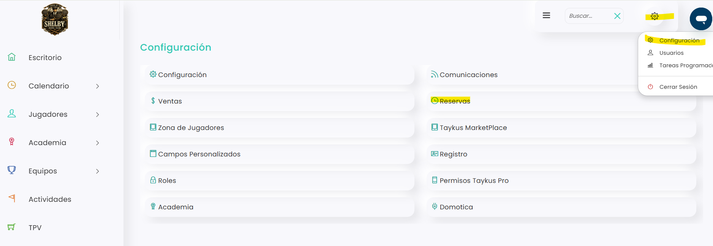
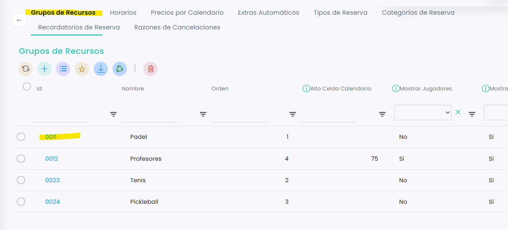
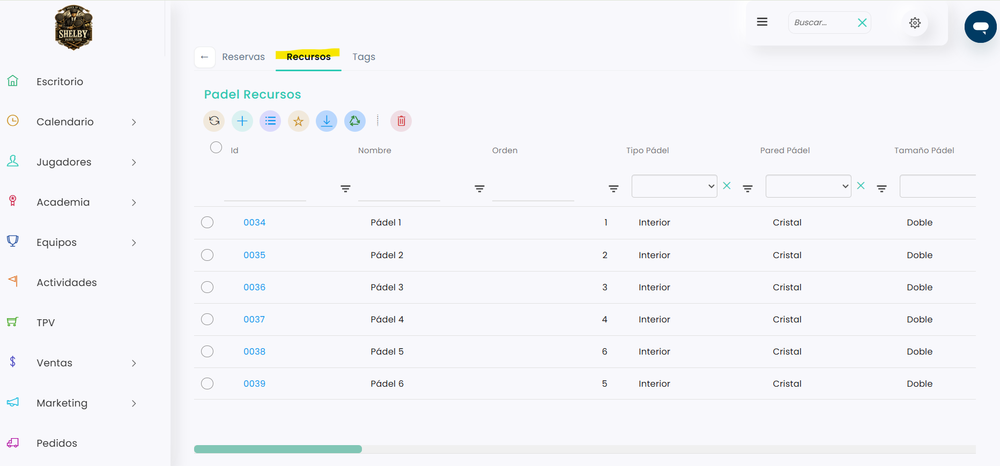
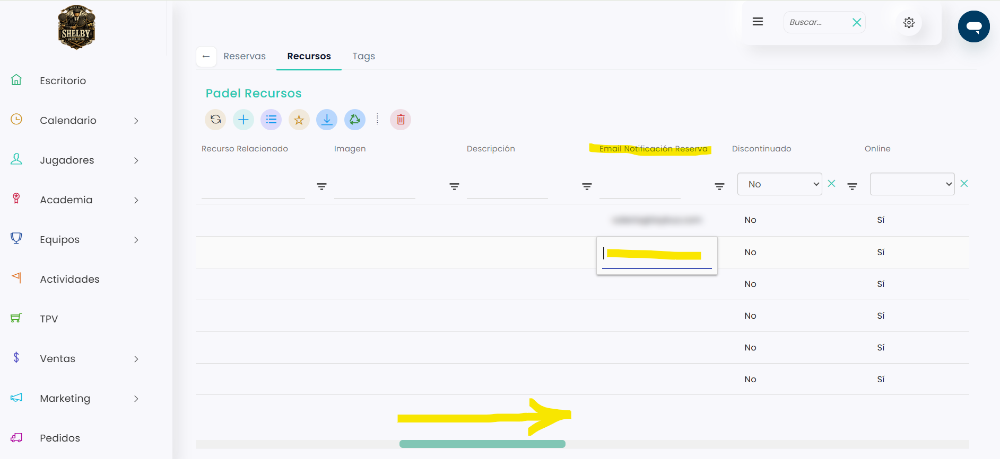
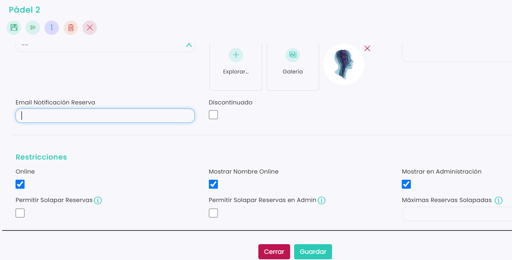

# Cómo recibir un email cuando alguien reserva o cancela

Si quieres que al club le llegue un correo cada vez que se reserva o se cancela una pista, tienes que escribir ese correo en el campo **Email Notificación Reserva** de la pista. El aviso llega con cualquier reserva: las que hace el club y las que hacen los clientes desde la web o la app.

> **Importante:** el correo se pone pista por pista, y cada pista admite un solo correo. Si quieres recibir los avisos de todas las pistas, tendrás que ponerlo en cada una.

A continuación, se detallan los pasos a seguir:



### Acceso a Grupo de recursos

* Clica en el icono <i class="fa-gear" style="color:blue;">:gear:</i> de la esquina superior derecha y entra en **Configuración**.
*   Clica en **Reservas**.

    <figure><figcaption></figcaption></figure>
*   Se abrirá directamente el bloque **Grupos de Recursos**. Clica en el **Id** del deporte (por ejemplo, Pádel).

    <figure><figcaption></figcaption></figure>



### Abrir el listado de pistas

*   Entra en la pestaña **Recursos**. Verás todas las pistas de ese deporte.

    <figure><figcaption></figcaption></figure>



### Añadir el correo

Puedes hacerlo de dos formas:

**Desde el listado (la más rápida)**

* Haz scroll hacia la derecha hasta la columna **Email Notificación Reserva**.
*   Clica en la casilla de la pista, escribe el correo y pulsa **Enter** para guardarlo.

    <figure><figcaption></figcaption></figure>

**Desde la ficha de cada pista**

* Clica en el **Id** de la pista.
* Haz scroll hacia abajo hasta el campo **Email Notificación Reserva** y escribe el correo.
*   Clica en **Guardar**.

    <figure><figcaption></figcaption></figure>



A partir de ese momento, te llegará un correo cada vez que se haga o se cancele una reserva en esa pista.

> Los profesores también pueden recibir un aviso de sus reservas en su propio correo. Para saber cómo, consulta este artículo:
>
> <a href="como-avisar-por-email-a-un-profesor-cuando-tiene-una-reserva.md" class="button primary">Cómo avisar por email a un profesor cuando tiene una reserva</a>
