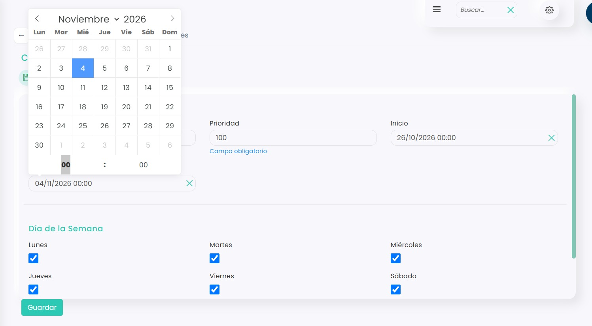

# Cómo cerrar el club entre dos fechas

Puedes cerrar el club varios días seguidos, por ejemplo por vacaciones u obras, para que no se pueda reservar en ninguna pista entre esas fechas. Se hace con un horario de cierre propio, con una fecha de inicio y otra de fin.

> **Importante:** las reservas que ya estén hechas en esas fechas no se cancelan solas. Tendrás que cancelarlas a mano. Para saber cómo, consulta este artículo:
>
> <a href="https://app.gitbook.com/s/hSQoRJmdDmzxYVh7vpFW/calendario/calendario/reservas/como-cancelar-una-reserva" class="button primary">Cómo cancelar una reserva</a>

A continuación, se detallan los pasos a seguir:



### Acceso a Horarios

* Clica en el icono <i class="fa-gear" style="color:blue;">:gear:</i> de la esquina superior derecha y entra en **Configuración**.
*   Clica en **Reservas**.

    
<figure><figcaption></figcaption></figure>

*   Clica en el bloque **Horarios**.

    
<figure><figcaption></figcaption></figure>




### Crear el horario del cierre

> **Importante:** no uses el horario **Cerrado** de los días sueltos. Si le pones fechas de inicio y fin, los días que tengas en **Excepciones** dejan de funcionar fuera de esas fechas. Crea siempre un horario aparte para los cierres largos. Para saber cómo crear un horario, consulta este artículo:
>
> <a href="como-crear-un-horario.md" class="button primary">Cómo crear un horario</a>

* Clica en :heavy\_plus\_sign:.
* Se abrirá esta ventana:

<figure><figcaption></figcaption></figure>

* **Nombre:** uno que lo identifique, por ejemplo _Cerrado vacaciones_.
* **Prioridad:** tiene que ser mayor que la de los demás horarios. Te recomendamos _100_.
* **Inicio:** el primer día de cierre, a las 00:00.
* **Fin:** el día **siguiente** al último día de cierre, a las 00:00.
* **Día de la Semana:** marca todos los días, de lunes a domingo.
* No añadas nada en **Horas de apertura** y clica en **Guardar**.

> **Importante:** el cierre termina justo en la fecha y hora de **Fin**. Por ejemplo, para cerrar del 26 de octubre al 3 de noviembre, ambos incluidos, pon de inicio el 26/10 a las 00:00 y de fin el 04/11 a las 00:00.



Durante esas fechas el club estará cerrado en todas las pistas. Al llegar la fecha de fin, vuelve solo a su horario de siempre, sin que tengas que hacer nada.
