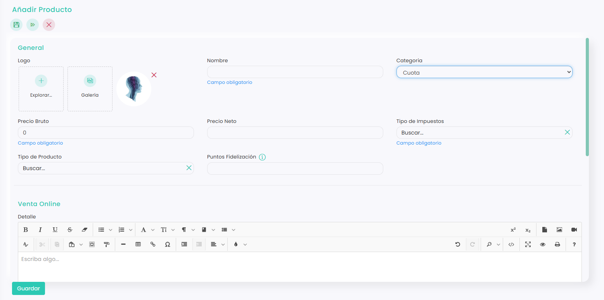
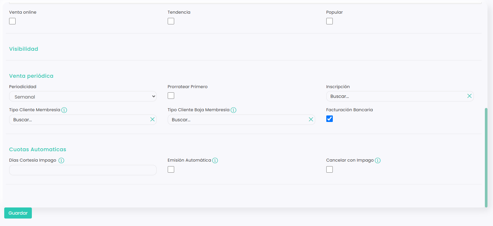

# Cómo crear un producto tipo Cuota

Los productos de tipo **Cuota** son los que se cobran de forma periódica, como una mensualidad, una cuota trimestral o una suscripción anual. En su ficha se define cada cuánto se cobran y cómo, para que el sistema gestione los cobros recurrentes.

A continuación, se detallan los pasos a seguir:



### Acceso a Productos

* Clica en el icono <i class="fa-gear" style="color:blue;">:gear:</i> de la esquina superior derecha y entra en **Configuración**.
* Clica en **Ventas**. Se abrirá directamente la pestaña **Productos**.



### Crear el producto

* Clica en :heavy\_plus\_sign:.
* Se abrirá la ficha del producto.



### General

<figure><figcaption></figcaption></figure>

* **Logo:** opcional. Ayuda a reconocer el producto en el TPV. Puedes subir una imagen con **Explorar…** o elegir una de la **Galería**.
* **Nombre:** nombre descriptivo de la cuota. Campo obligatorio.
* **Categoría:** viene marcada como **Artículo** por defecto. Cámbiala a **Cuota**.
* **Precio bruto:** precio de venta al público, con impuestos. Campo obligatorio.
* **Precio neto:** precio sin impuestos. Se calcula automáticamente según el tipo de impuesto.
* **Tipo de impuestos:** elige en el desplegable el impuesto que se aplica a la cuota. Campo obligatorio.
* **Tipo de producto:** elige uno de los tipos de producto que ya tengas creados.
* **Puntos de fidelización:** cantidad que se recarga en el bono monedero del cliente por cada unidad comprada, en la unidad mínima de tu moneda (en euros, céntimos). Por ejemplo, si escribes 2, el cliente recibe 2 céntimos por cada unidad que compre.



### Venta online

* **Detalle:** texto opcional para explicar las condiciones de la cuota.
* **Venta online:** márcala si se puede comprar por internet.
* **Tendencia:** destaca la cuota en la venta online como opción recomendada.
* **Popular:** marca la cuota como opción popular.



### Venta periódica

<figure><figcaption></figcaption></figure>

* **Periodicidad:** elige en el desplegable cada cuánto se cobra la cuota.
* **Prorratear primero:** márcala para que, al inscribirse a mitad de periodo, el primer cobro sea proporcional.
* **Inscripción:** para añadir una matrícula o precio de inscripción.
* **Tipo Cliente Membresía:** al suscribirse a la cuota, el cliente pasa automáticamente a tener este tipo de cliente.
* **Tipo Cliente Baja Membresía:** al terminar la cuota, el cliente pasa automáticamente a tener este tipo de cliente.
* **Facturación bancaria:** márcala si la cuota se cobra por domiciliación.

> **Membresías:** con los dos campos de tipo de cliente, una cuota funciona como la de un gimnasio. Mientras el cliente la tiene, pasa a ser del tipo que elijas (por ejemplo, **Socio**) y disfruta de sus ventajas, como precios especiales. Cuando la cuota termina, pasa al tipo de baja que hayas indicado.



### Cuotas automáticas

* **Días Cortesía Impago:** número de días que se esperan tras un impago antes de dar de baja la membresía.
* **Emisión Automática:** márcala para que las cuotas se emitan solas, sin tener que hacerlo a mano desde el calendario de cuotas.
* **Cancelar con Impago:** si se produce un impago, cancela la cuota y lo que la originó (por ejemplo, la inscripción a una actividad o a un grupo de escuela).

> En los desplegables solo aparecen cinco opciones. Si no ves la que buscas, empieza a escribir su nombre.



### Guardar

* Clica en **Guardar**.



Una vez creada, puedes gestionar las cuotas de cada jugador. Para saber cómo, consulta este artículo:

<a href="../../../../ventas/ventas/cuotas/como-ver-las-cuotas.md" class="button primary">Cómo ver las cuotas</a>
