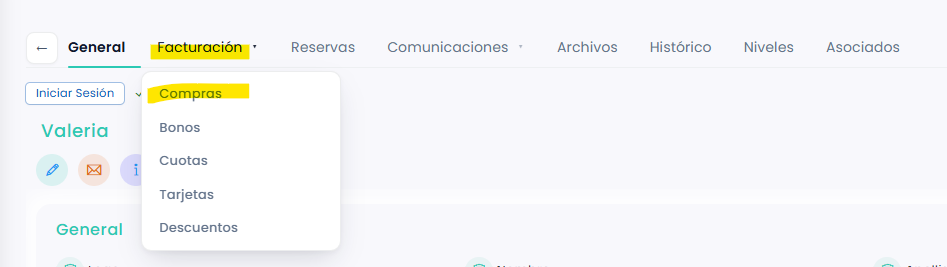
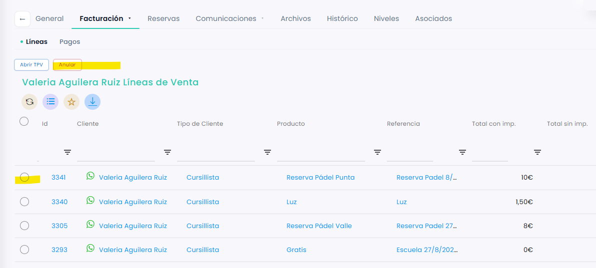
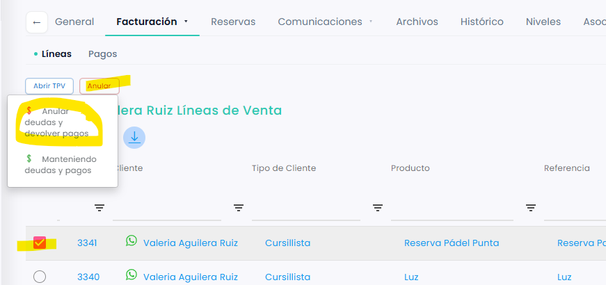
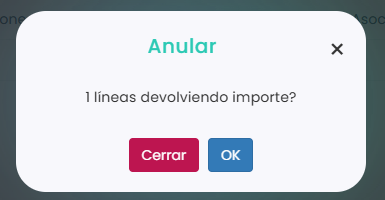

# Cómo anular una venta desde la ficha del jugador

Puedes anular una venta de un jugador directamente desde su ficha, sin tener que buscarla en **Ventas › Líneas**. Desde la ficha se anula la línea de venta completa.

A continuación, se detallan los pasos a seguir:



### Abrir la ficha del jugador

*   Dirígete al menú lateral izquierdo y selecciona **Jugadores**.

    <figure><figcaption></figcaption></figure>
* Busca al jugador con los filtros de la tabla (por ejemplo, por nombre).
* Clica en su **Id** para abrir su ficha.



### Ir a sus compras

*   Clica en la pestaña **Facturación** y, en el desplegable, elige **Compras**.

    <figure><figcaption></figcaption></figure>
* Se abre la pestaña **Líneas**, con todas las ventas del jugador.



### Seleccionar la venta

*   Marca el círculo de la izquierda de la venta que quieres anular.

    <figure><figcaption></figcaption></figure>
* Clica en **Anular**.



### Elegir la opción de anular

*   Se abre un desplegable. Elige **Anular deudas y devolver pagos**.

    <figure><figcaption></figcaption></figure>
*   Se abre una ventana que te pide confirmación:

    <figure><figcaption></figcaption></figure>
* Clica en **OK** para anularla, o en **Cerrar** si no quieres anularla.



> **Importante:** si al anular hay que devolver un pago en efectivo o con tarjeta, necesitas tener una caja abierta. Si es la devolución de un pago online, no hace falta.

También puedes anular ventas desde **Ventas › Líneas**. Consulta [Cómo anular una venta desde Líneas](../../../ventas/ventas/lineas/como-anular-una-venta-desde-lineas.md).
