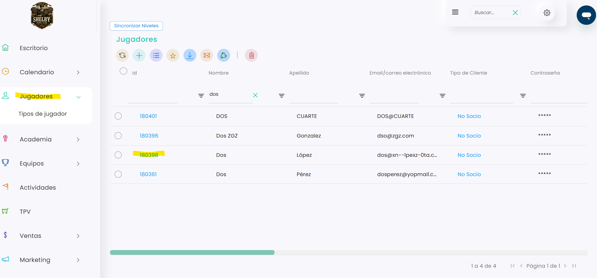
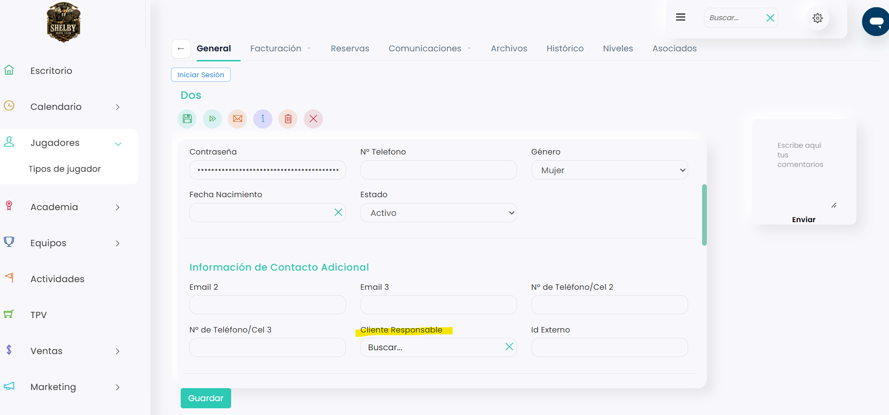
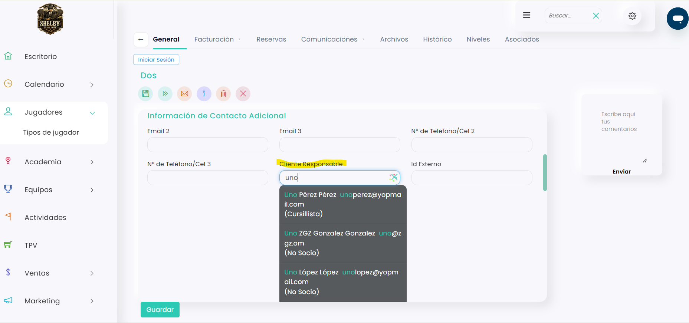
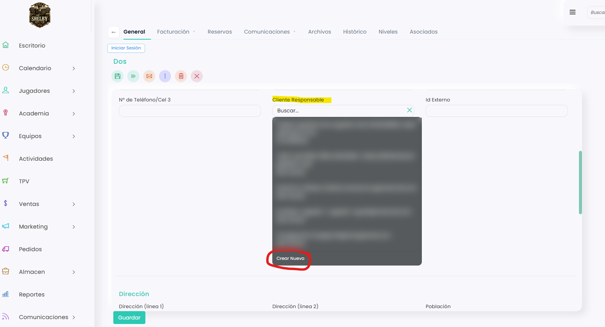
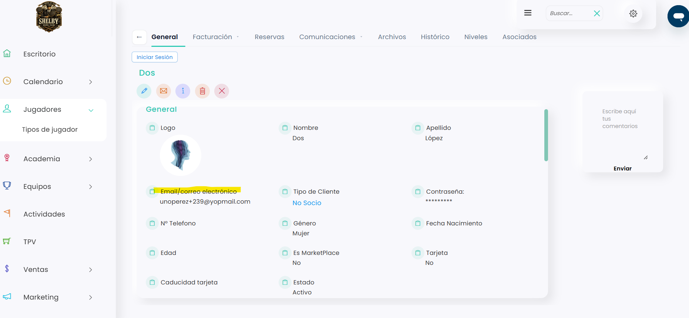
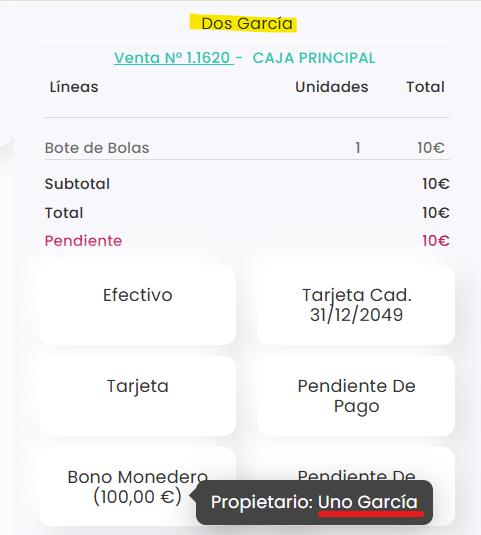

# Cómo asignar un cliente responsable a un jugador

El cliente responsable es la persona que se hace cargo de otra ficha de jugador: por ejemplo, una madre con su hijo, una pareja o un grupo de amigos. Al relacionarlas, la ficha asociada puede usar el correo, el teléfono y los métodos de pago del cliente responsable.

> **Importante:** el cliente responsable se asigna desde la ficha de la persona asociada, no desde la del responsable. Por ejemplo, para relacionar a un hijo con su madre, entra en la ficha del hijo y elige a la madre como **Cliente Responsable**.

A continuación, se detallan los pasos a seguir:



### Acceso a la ficha del jugador

* Dirígete al menú lateral izquierdo y selecciona **Jugadores**.
* Busca al jugador que quieres asociar con los filtros de la tabla (por ejemplo, por nombre).
*   Clica en su **Id** para abrir su ficha.

    <figure><figcaption></figcaption></figure>



### Editar la ficha

* Clica en el icono <i class="fa-pen">:pen:</i> para editar la ficha.



### Elegir el cliente responsable

* Haz scroll hacia abajo hasta el apartado **Información de Contacto Adicional**.
*   En el campo **Cliente Responsable**, escribe cualquier dato de la persona: nombre, apellido, DNI, correo…

    <figure><figcaption></figcaption></figure>
*   Selecciona a la persona en la lista de resultados.

    <figure><figcaption></figcaption></figure>
*   Si todavía no está dada de alta, clica en **Crear Nuevo**, al final de la lista. Se abre la ficha para crear un jugador nuevo. Para saber cómo rellenarla, consulta este artículo:

    <figure><figcaption></figcaption></figure>

    <a href="como-crear-a-un-jugador.md" class="button primary">Cómo crear a un jugador</a>



### Guardar

* Clica en **Guardar**.



## Qué cambia al asignar un cliente responsable

### Correo y teléfono

Si la ficha asociada tiene vacíos los campos **Email/correo electrónico** o **Nº Telefono**, al guardar se completan con los del cliente responsable.

Como un correo no se puede repetir en dos fichas, el programa añade automáticamente un **+** y un número delante de la @. Por ejemplo, si el correo del responsable es `unoperez@yopmail.com`, el de la ficha asociada queda como `unoperez+239@yopmail.com`. Es un correo que funciona: todo lo que se envíe a la ficha asociada llega al correo del cliente responsable.

<figure><figcaption></figcaption></figure>

> **Importante:** si la ficha asociada ya tiene correo o teléfono propios, no se cambian, y lo que se envíe a esa ficha sigue llegando a su propio correo.

### Cobros en el TPV

Al cobrar en el **TPV** una venta de la ficha asociada, aparecen como formas de pago la tarjeta guardada y el **Bono Monedero** del cliente responsable. Si pasas el ratón por encima de cualquiera de los dos, verás el nombre de su propietario.

<figure><figcaption></figcaption></figure>

### Zona de clientes

El cliente responsable puede entrar en la zona de clientes con su usuario y contraseña y cambiar a las cuentas de sus asociados, por ejemplo, para pagar con su bono o su tarjeta guardada. Para saber cómo, consulta este artículo:

<a href="../../../zona-de-clientes/zona-de-clientes/como-cambiar-entre-tu-cuenta-y-la-de-tus-asociados-en-la-zona-de-clientes.md" class="button primary">Cómo cambiar entre tu cuenta y la de tus asociados en la zona de clientes</a>

La persona asociada solo puede entrar por su cuenta si tiene un correo propio. Si no lo tiene, tiene que entrar con la cuenta del cliente responsable.

## Cosas a tener en cuenta

* Cada jugador solo puede tener un cliente responsable.
* Un mismo cliente responsable puede tener varios jugadores asociados.
* Para quitar la relación, edita la ficha asociada, vacía el campo **Cliente Responsable** y clica en **Guardar**.

> **Importante:** al quitar la relación, el correo generado (con el **+** y el número) se queda en la ficha y el programa no avisa. Si quieres que lo que se envíe a esa ficha deje de llegar al antiguo responsable, cambia el correo por el de la propia persona.

Para ver qué jugadores tiene asociados un cliente responsable, consulta este artículo:

<a href="como-ver-los-clientes-asociados-a-un-jugador.md" class="button primary">Cómo ver los clientes asociados a un jugador</a>
