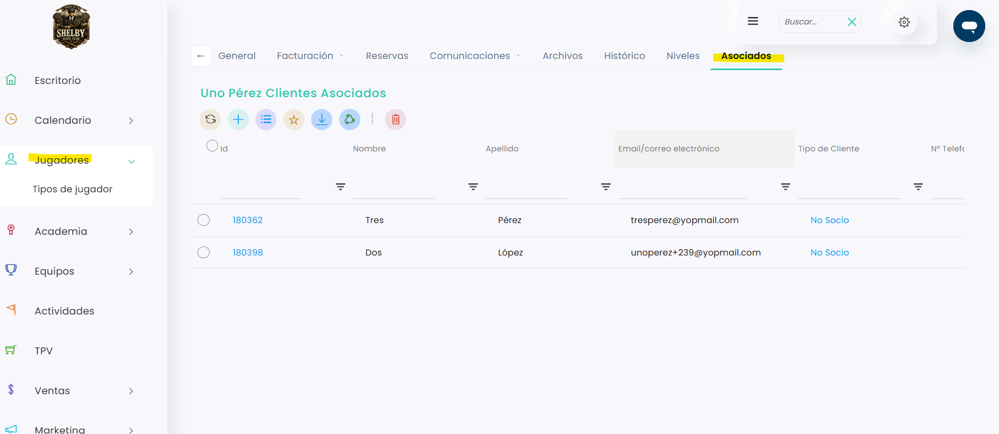

# Cómo ver los clientes asociados a un jugador

Desde la ficha de un cliente responsable puedes consultar qué jugadores lo tienen asignado como **Cliente Responsable**.

A continuación, se detallan los pasos a seguir:



### Acceso a la ficha del cliente responsable

* Dirígete al menú lateral izquierdo y selecciona **Jugadores**.
* Busca al cliente responsable con los filtros de la tabla (por ejemplo, por nombre).
* Clica en su **Id** para abrir su ficha.



### Pestaña Asociados

*   Clica en la pestaña **Asociados**, en la parte superior de la ficha. Verás la lista de jugadores asociados a este cliente.

    <figure><figcaption></figcaption></figure>
* Para abrir la ficha de un asociado, clica en su **Id**.



> **Importante:** la pestaña **Asociados** solo muestra jugadores en la ficha del cliente responsable. En la ficha de un jugador asociado, su responsable aparece en el campo **Cliente Responsable**.

Para relacionar a un jugador con su cliente responsable, consulta este artículo:

<a href="como-asignar-un-cliente-responsable-a-un-jugador.md" class="button primary">Cómo asignar un cliente responsable a un jugador</a>
