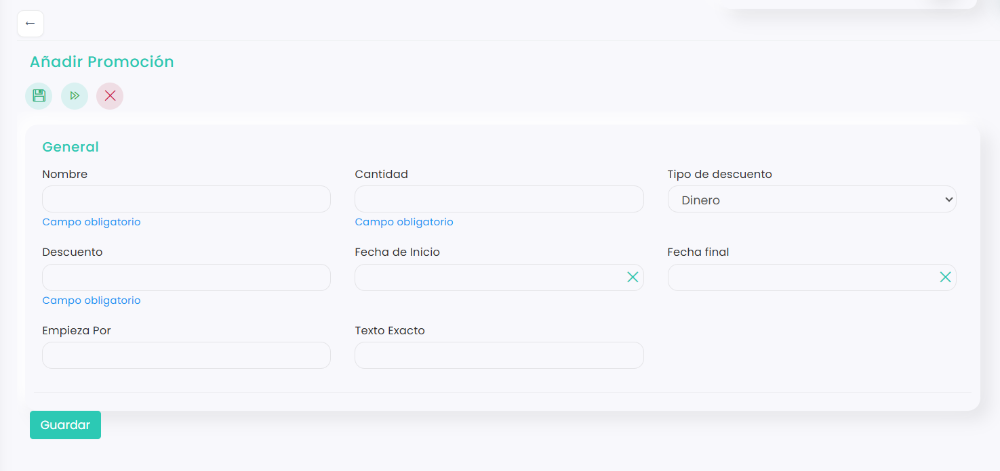

# Cómo hacer un código promocional

Los códigos promocionales permiten aplicar descuentos de forma rápida y controlada sobre reservas, productos o servicios. Son una herramienta útil para campañas puntuales, fidelización de clientes o promociones especiales. En este artículo aprenderás cómo crear un código promocional paso a paso y configurarlo correctamente según tus necesidades.



### Acceso a Códigos promocionales

* Dirígete al menú lateral izquierdo y selecciona **Marketing.**
*   En el desplegable, haz clic en **Códigos Promocionales**, y directamente se redirigirá a la pestaña de **Promociones.** 

    <figure><figcaption></figcaption></figure>



### Crear código promocional

* Clica en :heavy\_plus\_sign:
*   Se abre una sección que se deberá cumplimentar de la siguiente manera:

    <figure><figcaption></figcaption></figure>

    * **Nombre:** Nombre interno de la promoción para identificarla en el sistema. Se recomienda usar un nombre claro que permita reconocer fácilmente el código.
    * **Cantidad:** Número de veces que se podrá usar el código, con un máximo de **1000**. Por ejemplo, si escribes 50, el sistema crea el mismo código 50 veces y podrá utilizarse 50 veces en total.
    * **Tipo de descuento:** Define cómo se aplicará el descuento. Puede ser en **dinero** (importe fijo) o en **porcentaje** sobre el precio.
    * **Descuento:** Valor del descuento que se aplicará según el tipo seleccionado.
    * **Fecha de inicio:** Fecha a partir de la cual el código estará activo. Si se deja vacía, el código estará activo desde el momento en que se guarde.
    * **Fecha final:** Fecha límite de validez del código. A partir de ese día dejará de funcionar automáticamente. Si se deja vacía, el código no caduca.
    * **Empieza por:** Prefijo con el que empezarán los códigos que genere el sistema automáticamente (por ejemplo, `VER-`).
    * **Texto exacto:** Código fijo que eliges tú y que deberá introducir el cliente (por ejemplo, `VERANO10`). Es el texto que se compartirá públicamente.

    > **Importante:** Rellena solo uno de los dos campos: **Empieza por** o **Texto exacto**.
* Clica en **Guardar**.



### Comprobar el funcionamiento del código

* Dirígete a la web o app y haz una reserva.
* Cuando llegues al resumen de la reserva, introduce el código promocional.
*   Haz clic en **Aplicar código**. 

    <figure><figcaption></figcaption></figure>

* Si el código está correctamente creado, el descuento se aplicará automáticamente.
*   Si el código se ha creado o introducido de forma incorrecta, aparecerá en pantalla un mensaje de error indicando que no puede aplicarse. 

    <figure><figcaption></figcaption></figure>



Crear y verificar un código promocional correctamente garantiza que los descuentos se apliquen sin errores y evita incidencias en caja o en reservas online. Recomendamos siempre probar el código antes de compartirlo con los clientes para asegurarse de que funciona según lo previsto.

Si quieres que el descuento solo se aplique a algunos productos, consulta este artículo:

<a href="como-limitar-un-codigo-promocional-a-ciertos-productos.md" class="button primary">Cómo limitar un código promocional a ciertos productos</a>
