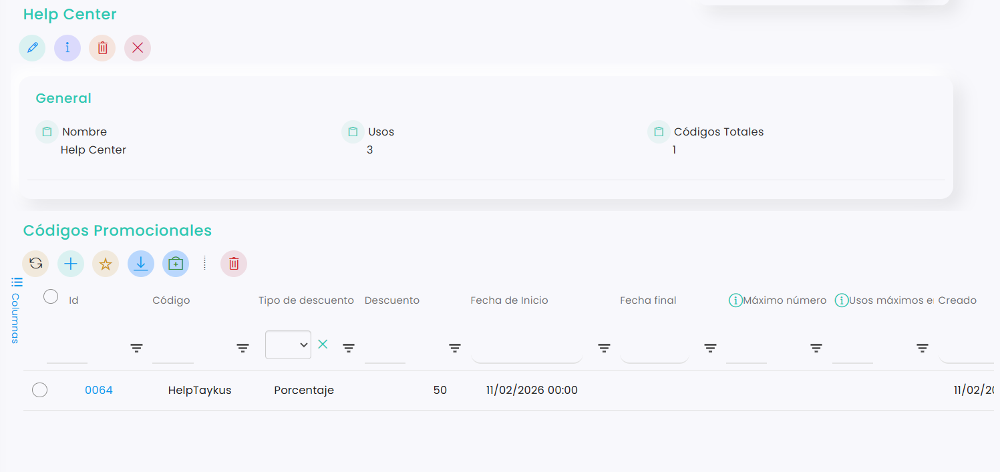
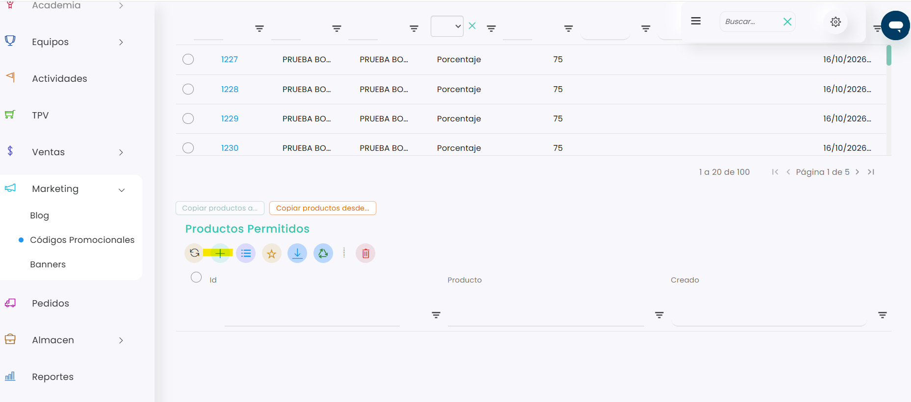
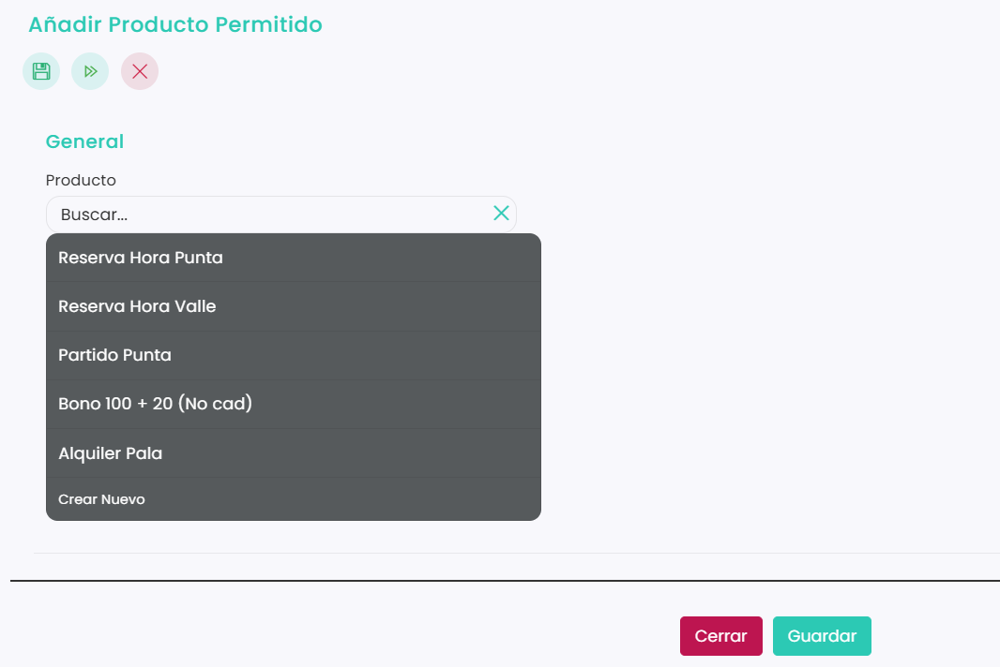

# Cómo limitar un código promocional a ciertos productos

Puedes hacer que un código promocional solo se aplique a los productos que elijas, por ejemplo a las reservas en hora valle o al alquiler de pala. Primero se crea el código y, después, se añaden los productos permitidos desde la propia promoción.

A continuación, se detallan los pasos a seguir:



### Acceso a Códigos promocionales

* Dirígete al menú lateral izquierdo y selecciona **Marketing.**
*   En el desplegable, haz clic en **Códigos Promocionales**, y directamente se redirigirá a la pestaña de **Promociones.** 

    <figure><figcaption></figcaption></figure>

> **Importante:** El código promocional debe estar creado antes de limitarlo. Si aún no lo has hecho, consulta [Cómo hacer un código promocional](como-hacer-un-codigo-promocional.md).



### Abrir la promoción

* Clica sobre el id de la promoción que quieres limitar.
*   Se abrirá el detalle de la promoción con sus códigos promocionales: 

    <figure><figcaption></figcaption></figure>



### Añadir los productos permitidos

* Haz scroll hacia abajo hasta el apartado **Productos Permitidos**.
*   Clica en :heavy\_plus\_sign: 

    <figure><figcaption></figcaption></figure>
*   En el campo **Producto**, busca y selecciona el producto al que se aplicará el descuento. 

    <figure><figcaption></figcaption></figure>
* Clica en **Guardar**.
* Repite estos pasos con cada producto que quieras añadir.



Una vez añadidos los productos, el descuento solo se aplicará a los productos de la lista. Recomendamos probar el código con un producto permitido y con uno que no lo esté antes de compartirlo con los clientes.
