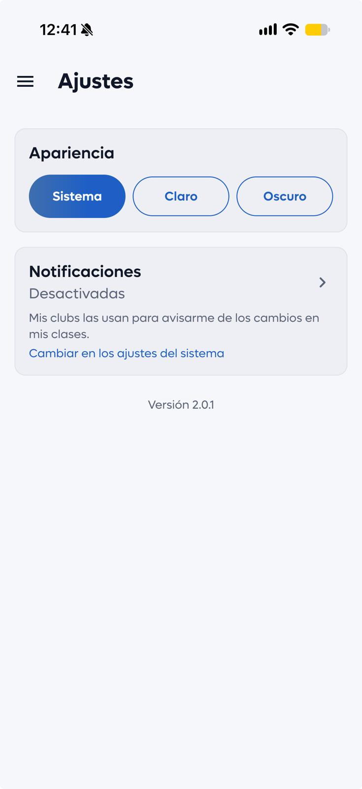

# Cómo cambiar los ajustes de Taykus Pro

En **Ajustes** puedes elegir si ves la app en modo claro u oscuro, y comprobar si tienes activadas las notificaciones con las que el club te avisa de los cambios en tus clases.

A continuación, se detallan los pasos a seguir:



### Acceso a Ajustes

* Clica en ☰ arriba a la izquierda y selecciona **Ajustes**.



### Elegir la apariencia

*   En **Apariencia**, elige:

    
<figure><figcaption></figcaption></figure>

    * **Sistema:** la app sigue el modo claro u oscuro de tu móvil.
    * **Claro:** siempre en modo claro.
    * **Oscuro:** siempre en modo oscuro.



### Activar las notificaciones

* En **Notificaciones** verás si están activadas o desactivadas.
* Para cambiarlo, clica en **Cambiar en los ajustes del sistema**. Se abrirán los ajustes de tu móvil, donde puedes activarlas para Taykus Pro.



> **Importante:** si tienes las notificaciones desactivadas, no te llegarán los avisos del club cuando cambie algo en tus clases.
