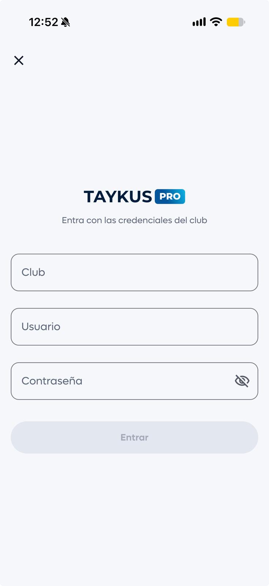
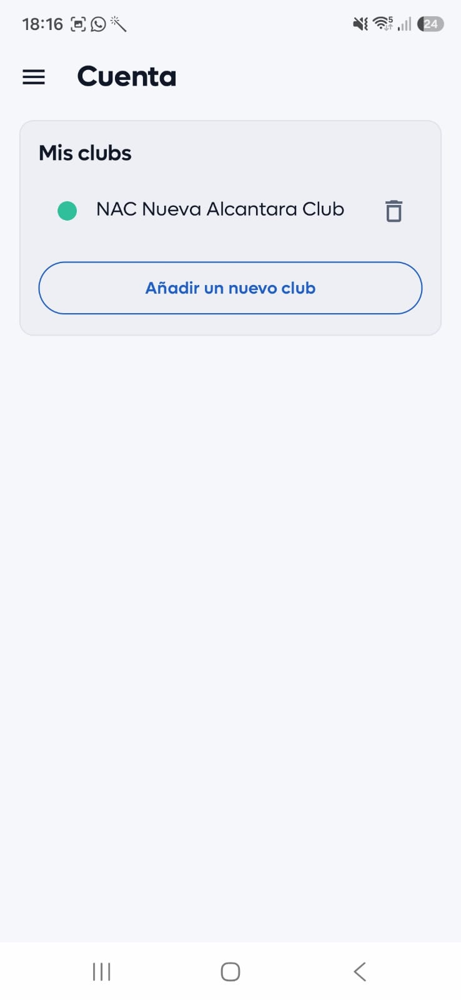

# Cómo entrar en Taykus Pro

Para entrar en Taykus Pro necesitas el usuario y la contraseña con los que entras en el panel de Taykus. Si trabajas en varios clubs, añade cada uno con sus propios datos.

A continuación, se detallan los pasos a seguir:



### Descargar la app

* Descarga **Taykus Pro** desde la [App Store](https://apps.apple.com/es/app/taykus-pro/id6804599678) (iPhone y iPad) o desde [Google Play](https://play.google.com/store/apps/details?id=com.taykus.coach) (Android).



### Escribir los datos de acceso

* **Club:** el nombre de tu club.
* **Usuario:** tu email.
* **Contraseña:** la misma que usas en el panel.
*   Clica en **Entrar**.

    
<figure><figcaption></figcaption></figure>




### Añadir otro club

* En **Inicio**, clica en **Añadir otro club**. También puedes hacerlo desde el menú: clica en ☰ arriba a la izquierda, entra en **Cuenta** y clica en **Añadir un nuevo club**.
* Escribe los datos de acceso de ese club y clica en **Entrar**.
*   Para quitar un club de la app, entra en **Cuenta** y clica en el icono de la papelera que hay a su lado.

    
<figure><figcaption></figcaption></figure>




> **Importante:** si no puedes entrar, pide al club que revise que tienes creado tu usuario y que tu rol tiene permisos en **Permisos Taykus Pro**.
