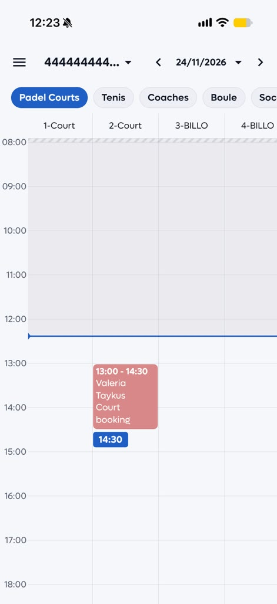
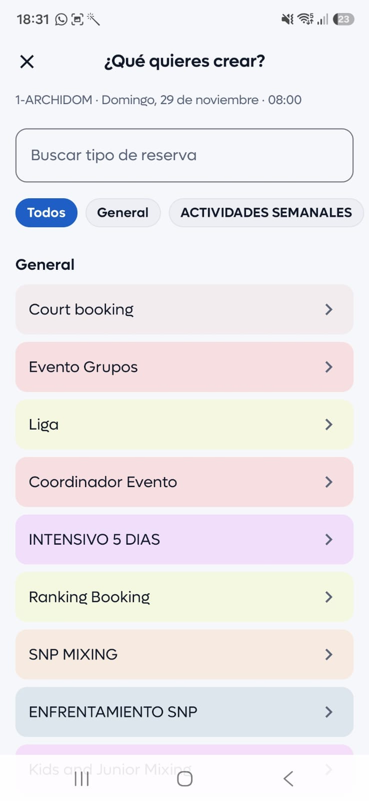
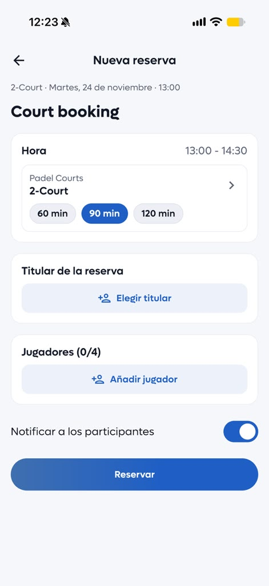
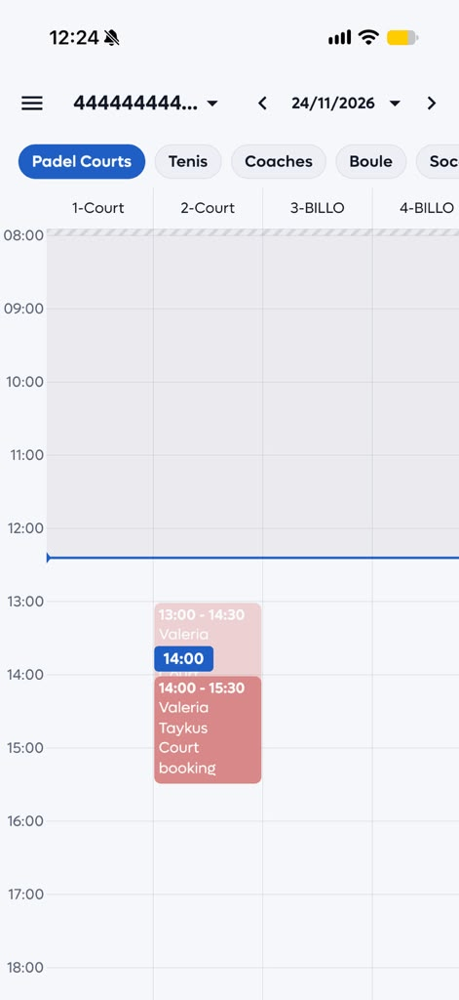
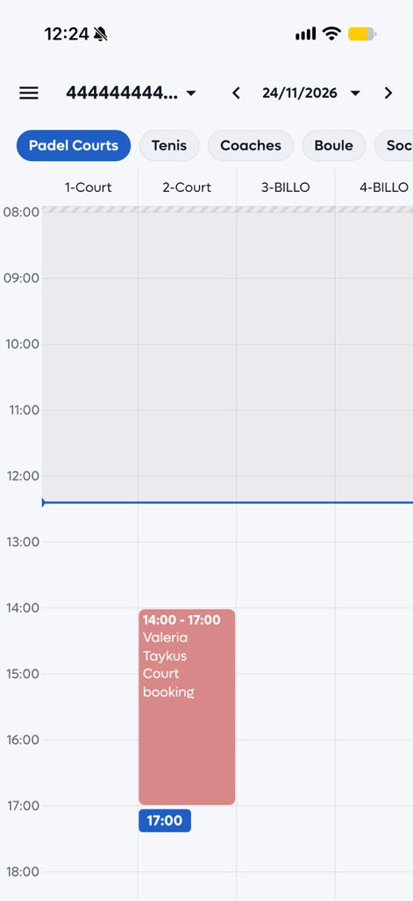
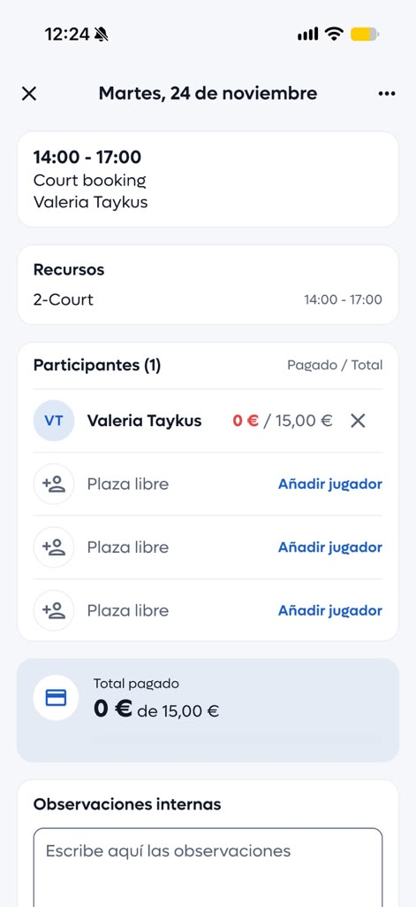
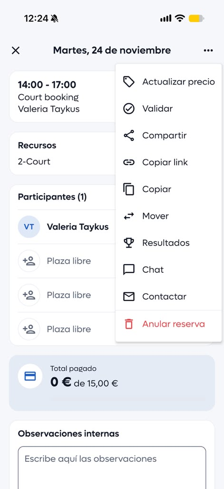
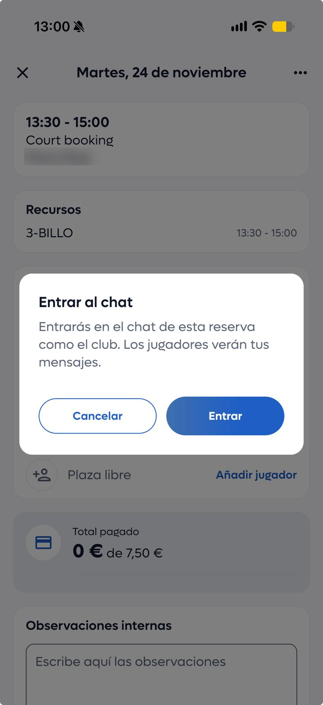
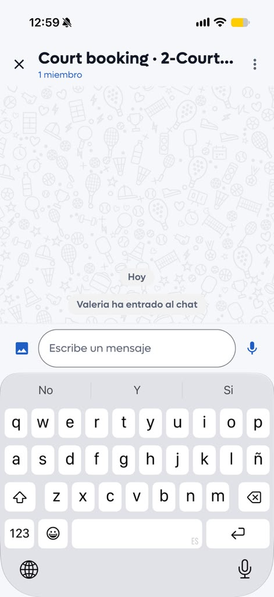

# Cómo usar el calendario en Taykus Pro

En **Calendario** ves las reservas del club día a día, pista por pista. Si tu rol lo permite, también puedes crear, mover, alargar o anular reservas.

A continuación, se detallan los pasos a seguir:



### Acceso al calendario

* Clica en ☰ arriba a la izquierda y selecciona **Calendario**.



### Elegir el día y los recursos

* Arriba, usa las flechas **‹** y **›** para cambiar de día, o clica en la fecha para elegirla.
* Debajo, cada botón es un grupo de recursos del club (por ejemplo, pistas de pádel, pistas de tenis o profesores). Clica en el que quieras ver.
* Desliza a los lados para ver el resto de pistas.
*   Si trabajas en varios clubs, clica en el nombre del club, arriba, para cambiar de club.

    
<figure><figcaption></figcaption></figure>




### Crear una reserva

* Clica en un hueco libre del calendario.
* Arriba verás la pista, el día y la hora que has elegido.
*   Busca el tipo de reserva o filtra por categoría, y clica en el que quieras.

    
<figure><figcaption></figcaption></figure>




### Rellenar la reserva

*   Se abre la ventana **Nueva reserva**:

    
<figure><figcaption></figcaption></figure>

    * **Hora:** elige la duración (por ejemplo, **60 min**, **90 min** o **120 min**). A la derecha verás la hora de inicio y de fin. Para cambiar de pista, clica en **›**.
    * **Titular de la reserva:** clica en **Elegir titular** y elige al jugador. El titular cuenta como uno de los jugadores.
    * **Jugadores:** clica en **Añadir jugador** para añadir a los demás. Entre paréntesis ves cuántos hay y cuántos caben.
    * **Notificar a los participantes:** déjalo activado si quieres avisar a los jugadores.
* Clica en **Reservar**.



### Mover o alargar una reserva

*   Para moverla, mantén pulsada la reserva y arrástrala a otra hora o a otra pista.

    
<figure><figcaption></figcaption></figure>

*   Para alargarla o acortarla, clica en el borde de abajo de la reserva y arrástralo hasta la nueva hora de fin. Verás la hora en azul mientras la arrastras.

    
<figure><figcaption></figcaption></figure>

* Al soltar la reserva, se abrirá una ventana para confirmar el cambio.



### Ver una reserva

* Clica en una reserva para abrirla. Verás el horario, el tipo de reserva, el titular, los recursos, los participantes con lo que ha pagado cada uno y el total pagado.
* Para añadir un jugador, clica en **Añadir jugador** en una plaza libre. Para quitarlo, clica en la **X** que hay a su lado.
*   En **Observaciones internas** puedes escribir notas sobre la reserva.

    
<figure><figcaption></figcaption></figure>




### Opciones de la reserva

*   Dentro de la reserva, clica en **⋯** arriba a la derecha:

    
<figure><figcaption></figcaption></figure>

    * **Actualizar precio:** vuelve a calcular el precio si ha cambiado algo en el tipo de reserva, para que se aplique el cambio.
    * **Validar:** valida la clase. Sale en todas las reservas, pero solo sirve para las clases.
    * **Compartir:** crea un mensaje con los datos de la reserva y su enlace, para enviarlo, por ejemplo, por WhatsApp.
    * **Copiar link:** copia solo el enlace de la reserva.
    * **Copiar:** copia la reserva para repetirla en otro día, pista u hora. Después, clica en el hueco donde quieres la copia.
    * **Mover:** otra forma de moverla. Después, clica en la nueva hora o pista.
    * **Resultados:** añade los resultados de la reserva.
    * **Chat:** entra en el chat de la reserva para hablar con los jugadores. Lo ves en el paso siguiente.
    * **Contactar:** envía un email a los participantes.
    * **Anular reserva:** cancela la reserva.



### Hablar con los jugadores de la reserva

* Dentro de la reserva, clica en **⋯** y después en **Chat**.
*   Se abre un aviso: entrarás en el chat de la reserva como el club y los jugadores verán tus mensajes. Clica en **Entrar**.

    
<figure><figcaption></figcaption></figure>

*   Escribe tu mensaje abajo, en **Escribe un mensaje**.

    
<figure><figcaption></figcaption></figure>



