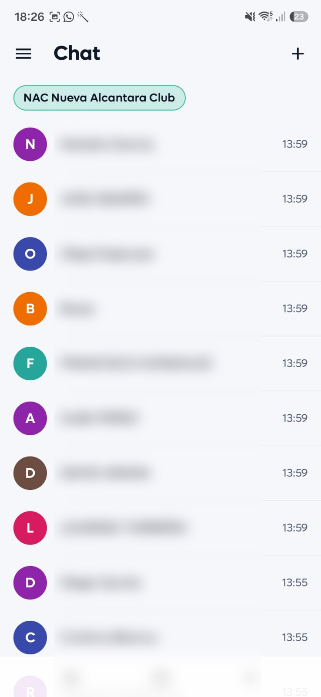
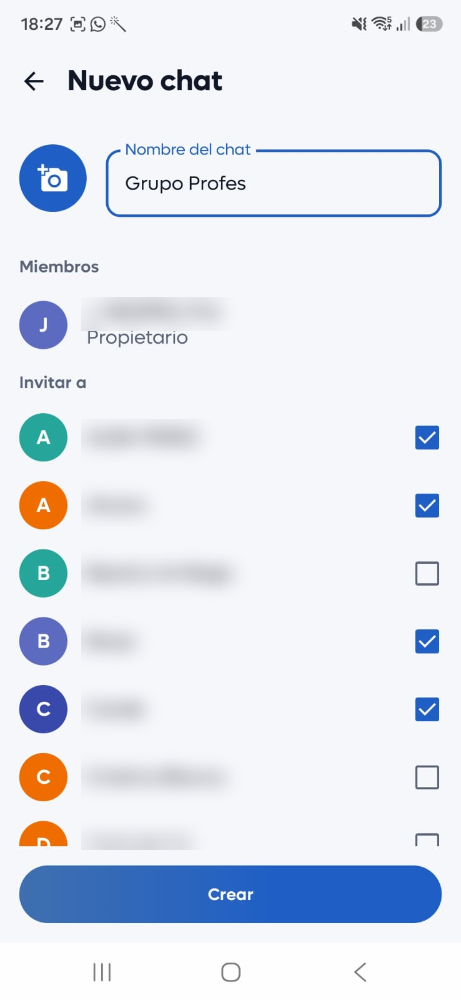

# Cómo usar el chat de Taykus Pro

Con el chat de Taykus Pro puedes hablar con otros trabajadores del club que tienen usuario en Taykus, uno a uno o en grupo. Para usarlo, tu rol necesita el permiso **Ver el chat**.

A continuación, se detallan los pasos a seguir:



### Acceso al chat

* Clica en ☰ arriba a la izquierda y selecciona **Chat**.
*   Verás tus conversaciones del club. Clica en un nombre para abrir la conversación con esa persona.

    
<figure><figcaption></figcaption></figure>




### Crear un grupo

* Clica en :heavy_plus_sign: arriba a la derecha.
* **Nombre del chat:** escribe el nombre del grupo. Por ejemplo, "Grupo Profes".
* Si quieres, clica en el icono de la cámara para ponerle una foto.
* En **Invitar a**, marca a las personas que quieres añadir.
*   Clica en **Crear**. Tú quedas como **Propietario** del grupo.

    
<figure><figcaption></figcaption></figure>



