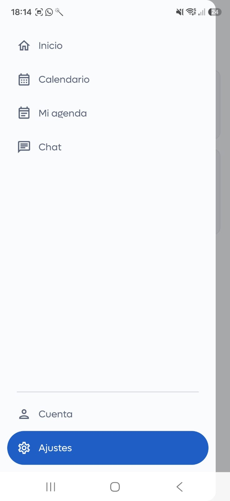
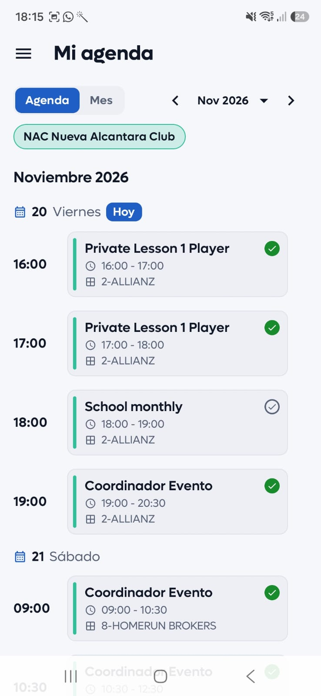
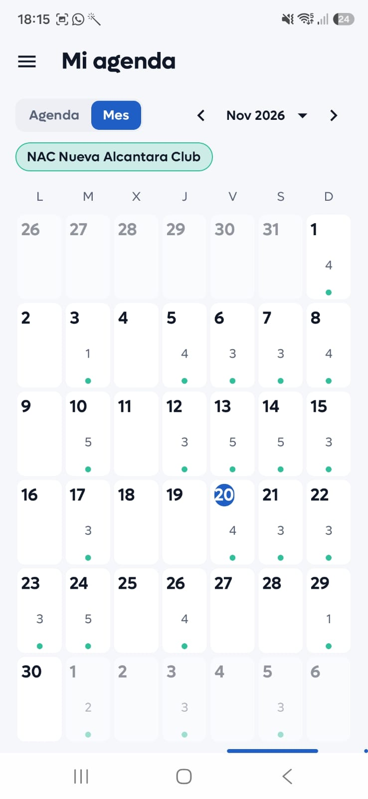

# Cómo ver tu agenda en Taykus Pro

En **Mi agenda** ves tus clases de todos tus clubs. Puedes verlas como una lista (Agenda) o como un mes completo (Mes).

A continuación, se detallan los pasos a seguir:



### Acceso a Mi agenda

* Clica en ☰ arriba a la izquierda y selecciona **Mi agenda**.
*   También puedes entrar desde **Inicio**, en **Ver mi agenda**.

    
<figure><figcaption></figcaption></figure>




### Vista Agenda

* Arriba, selecciona **Agenda**.
* Verás tus clases ordenadas por día, con el nombre de la clase, el horario y la pista.
*   El check verde indica que la clase ya está validada; el círculo gris, que aún no.

    
<figure><figcaption></figcaption></figure>




### Vista Mes

* Selecciona **Mes**.
* Cada día muestra cuántas clases tienes, con un punto del color del club.
*   Clica en un día para ver sus clases.

    
<figure><figcaption></figcaption></figure>




### Cambiar de mes

* Usa las flechas **‹** y **›** para ir al mes anterior o al siguiente, o clica en el mes para elegirlo.



### Elegir qué clubs ver

* Debajo de **Agenda** y **Mes**, cada club tiene su botón con su color.
* Clica en un club para seleccionarlo o quitarlo. Verás las clases de los clubs que tengas seleccionados.


