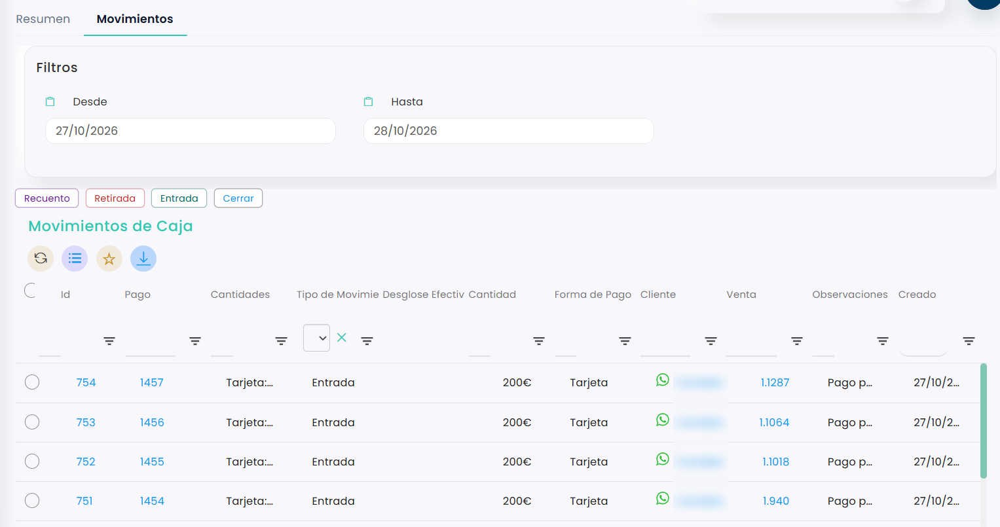

# Cajas

En **Ventas › Cajas** llevas el control del dinero que entra y sale del club. La pantalla tiene dos pestañas:

* **Resumen:** los totales de cobros por forma de pago y por tipo de producto, con sus gráficos, entre las fechas que elijas. Aquí solo se consulta y se puede exportar a Excel. Consulta [Cómo consultar y exportar el resumen de caja](como-consultar-y-exportar-el-resumen-de-caja.md).
* **Movimientos:** el listado de todas las operaciones de la caja (cobros, entradas, retiradas…). Desde aquí se hacen las operaciones de caja con los botones **Recuento**, **Retirada**, **Entrada** y **Cerrar**.

<figure><figcaption></figcaption></figure>

Si la caja está cerrada, primero tendrás que abrirla. Para cada operación, consulta estos artículos:

* [Cómo abrir la caja](como-abrir-la-caja.md)
* [Cómo hacer un recuento de caja](como-hacer-un-recuento-de-caja.md)
* [Cómo hacer una entrada o retirada de efectivo](como-hacer-una-entrada-o-retirada-de-efectivo.md)
* [Cómo cerrar la caja](como-cerrar-la-caja.md)
