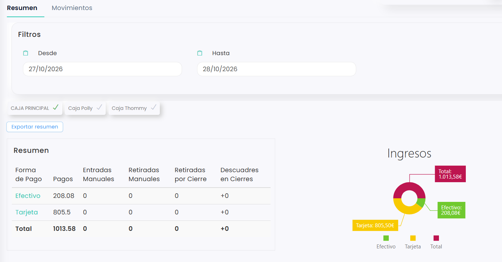
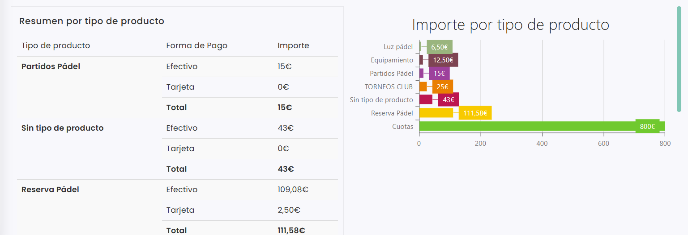
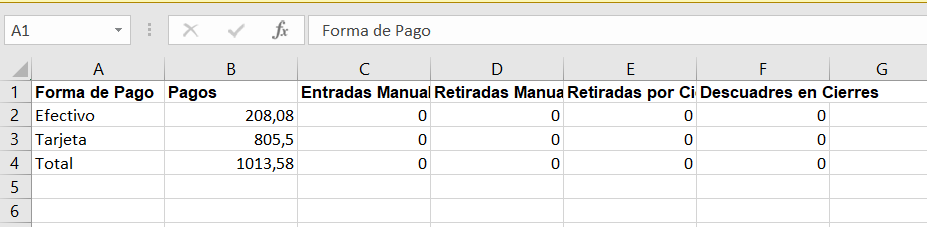

# Cómo consultar y exportar el resumen de caja

En la pestaña **Resumen** de **Ventas › Cajas** puedes ver cuánto se ha cobrado entre dos fechas, por forma de pago y por tipo de producto, y descargarlo en Excel. En esta pestaña solo se consulta: las operaciones de caja se hacen desde **Movimientos**.

A continuación, se detallan los pasos a seguir:



### Acceso al resumen

* Dirígete al menú lateral izquierdo y selecciona **Ventas**.
* En el desplegable, elige **Cajas**.
* Se abre directamente la pestaña **Resumen**.



### Elegir las fechas y las cajas

* En **Filtros**, indica las fechas **Desde** y **Hasta**. El día de **Hasta** no se incluye: para ver lo de un día, pon ese día en **Desde** y el día siguiente en **Hasta**. Por ejemplo, para ver lo del 27/10, pon del 27/10 al 28/10.
*   Debajo, marca las cajas que quieres incluir. Puedes marcar una o varias: las marcadas llevan el check verde. 

    <figure><figcaption></figcaption></figure>



### Consultar el resumen

* La tabla **Resumen** muestra, para cada forma de pago, los **Pagos**, las **Entradas Manuales**, las **Retiradas Manuales**, las **Retiradas por Cierre** y los **Descuadres en Cierres**, con el total abajo. A la derecha, el gráfico **Ingresos** muestra el reparto por forma de pago.
*   Más abajo, la tabla **Resumen por tipo de producto** muestra lo cobrado por cada tipo de producto (reservas, cuotas, equipamiento…) y forma de pago, con el gráfico **Importe por tipo de producto**. 

    <figure><figcaption></figcaption></figure>



### Exportar a Excel

*   Clica en **Exportar resumen**. Se descarga un Excel con la tabla **Resumen** por forma de pago. 

    <figure><figcaption></figcaption></figure>


