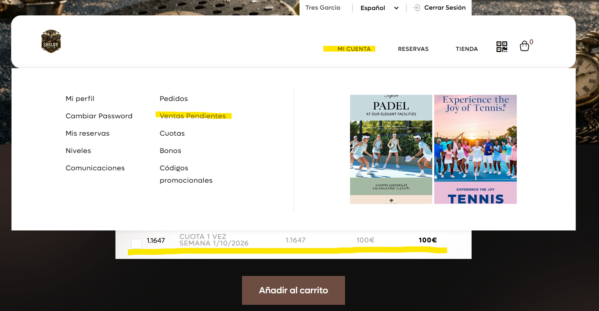
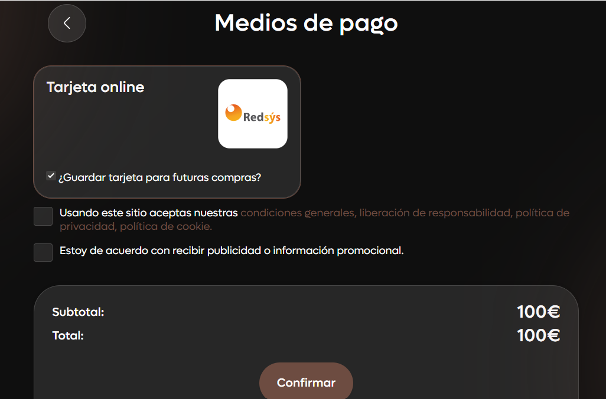
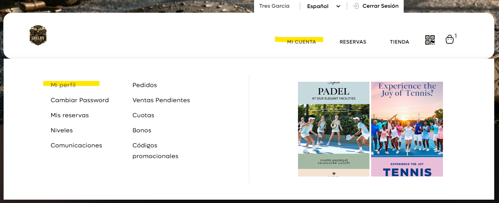
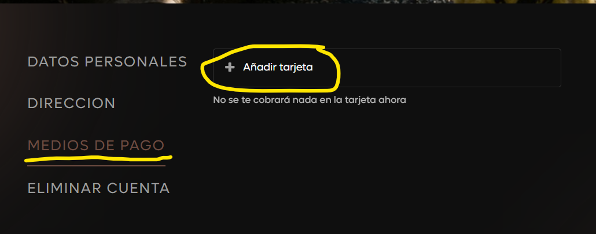
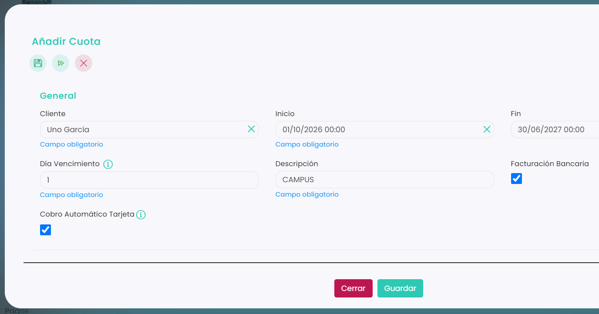
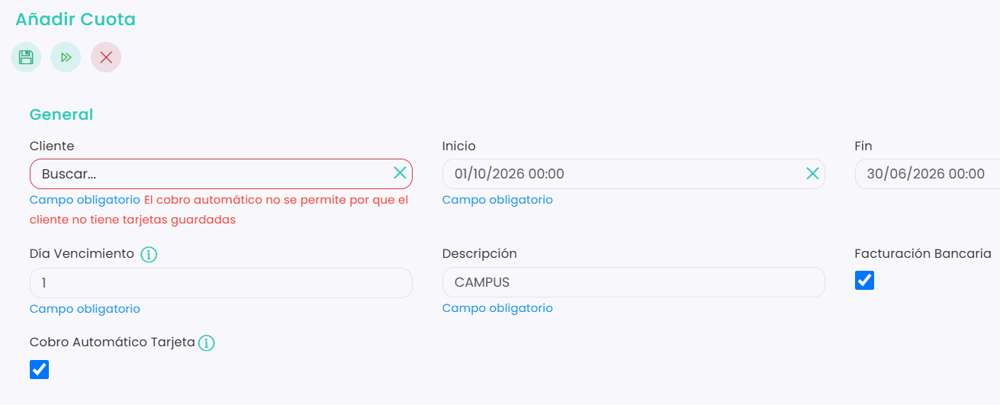
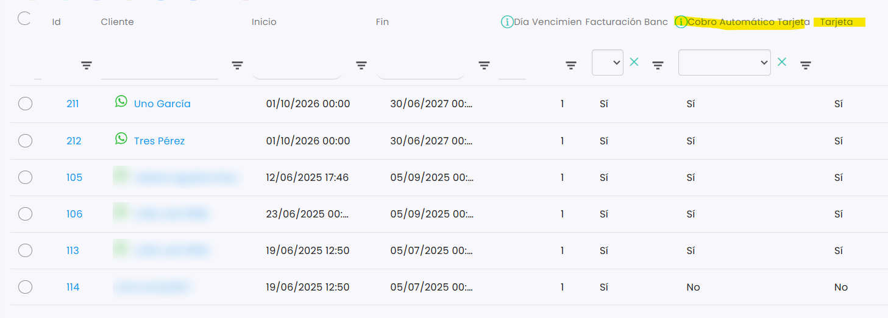
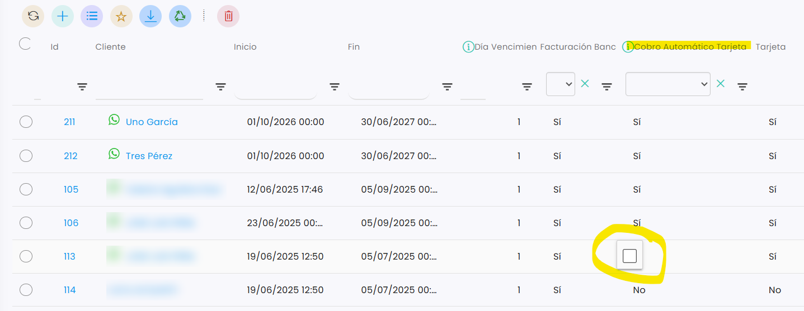

# Cómo activar el cobro automático con tarjeta

Si un jugador tiene una tarjeta guardada, puedes activar el cobro automático en su cuota: cuando llegue la fecha de vencimiento, la cuota se le cobrará automáticamente en esa tarjeta. Puedes activarlo al añadir al jugador a la cuota o más tarde, desde el listado de jugadores de la cuota.

> **Importante:** el cobro automático solo se puede activar si el cliente tiene una tarjeta guardada. Si un cobro automático falla, la cuota queda como deuda pendiente de pago en [Ventas › Deudas](../deudas/README.md).

### Antes de empezar: cómo guarda el cliente su tarjeta

El cliente puede guardar su tarjeta desde su zona de clientes de dos formas:

*   **Al pagar una cuota online.** Si la cuota está pendiente de pago, le aparece en **Mi cuenta › Ventas Pendientes** para pagarla. Si la contrata online, se añade al carrito. En los dos casos, al pagar con tarjeta, el sistema le obliga a guardarla. 

    <figure><figcaption></figcaption></figure>

    <figure><figcaption></figcaption></figure>
*   **Desde su perfil, sin pagar nada.** En **Mi cuenta › Mi perfil › Medios de pago**, con el botón **Añadir tarjeta**. No se le cobra nada en ese momento. 

    <figure><figcaption></figcaption></figure>

    <figure><figcaption></figcaption></figure>

A continuación, se detallan los pasos a seguir:



### Acceso a la cuota

* Dirígete al menú lateral izquierdo y selecciona **Ventas**.
* En el desplegable, elige **Cuotas**.
* Clica en el **Id** de la cuota.
* Entra en la pestaña **Jugadores**.



### Activarlo al añadir un jugador

* Clica en **+** para añadir un jugador a la cuota.
* Rellena los datos: **Cliente**, **Inicio**, **Fin**, **Día Vencimiento** y **Descripción**.
*   Marca la casilla **Cobro Automático Tarjeta**. 

    <figure><figcaption></figcaption></figure>
* Clica en **Guardar**.
*   Si el cliente no tiene ninguna tarjeta guardada, aparecerá un aviso en rojo y no podrás activar el cobro automático: 

    <figure><figcaption></figcaption></figure>



### Activarlo a un jugador que ya está en la cuota

*   En el listado de jugadores de la cuota, la columna **Tarjeta** indica si el cliente tiene tarjeta guardada y la columna **Cobro Automático Tarjeta**, si tiene el cobro automático activado. 

    <figure><figcaption></figcaption></figure>
*   Si el jugador tiene tarjeta, clica en su celda de la columna **Cobro Automático Tarjeta** y marca la casilla. Se guarda automáticamente. 

    <figure><figcaption></figcaption></figure>


