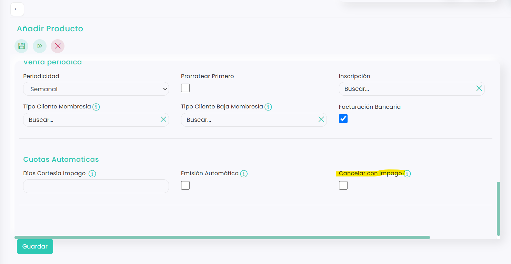

# Cómo automatizar la cancelación por impago

Puedes hacer que una cuota se cancele sola cuando el cliente no la paga. Así no se le siguen emitiendo recibos de los meses siguientes.

Se considera impago cualquiera de estos casos:

* Un recibo domiciliado que el banco devuelve.
* Un cobro automático con tarjeta que falla.
* Una cuota emitida que nadie paga.

A continuación, se detallan los pasos a seguir:



### Abrir la cuota

* Clica en el icono <i class="fa-gear" style="color:blue;">:gear:</i> de la esquina superior derecha y entra en **Configuración**.
* Clica en **Ventas**. Se abrirá directamente la pestaña **Productos**.
* En la columna **Categoría**, selecciona **Cuota** y clica en el **Id** de la cuota.
* Clica en el icono <i class="fa-pen">:pen:</i> para editarla.

> Si la cuota todavía no existe, puedes rellenar estos campos al crearla. Consulta [Cómo crear un producto tipo Cuota](../../../configuracion/configuracion/ventas/productos/como-crear-un-producto-tipo-cuota.md).



### Configurar la cancelación

*   En el bloque **Cuotas Automaticas**, rellena estos campos:

    <figure><figcaption></figcaption></figure>

    * **Días Cortesía Impago:** los días que se esperan, desde el vencimiento de la cuota, antes de cancelarla.
    * **Cancelar con Impago:** márcalo para que la cuota se cancele cuando pasen esos días sin pagar.
* Clica en **Guardar**.



## Qué pasa cuando se cancela

Cuando pasan los días de cortesía y la cuota sigue sin pagar:

* Dejan de emitirse las cuotas de los meses siguientes.
* La deuda que ya tenía **no se borra**: sigue emitida y pendiente de pago en [Ventas › Deudas](../deudas/README.md).
* Si la cuota es una membresía, el cliente pasa al tipo de cliente de baja (por ejemplo, de **Socio** a **No socio**). Consulta [Qué es una membresía y cómo funciona](que-es-una-membresia-y-como-funciona.md).
* El cliente recibe un correo avisándole de que su suscripción se ha cancelado. Es la plantilla **Notificación de subscripción cancelada**, que puedes revisar en [Plantillas de emails](../../../comunicaciones/comunicaciones/plantillas-de-emails.md).

> **Importante:** cancelar la cuota no le da de baja de la actividad ni del grupo de academia en el que esté inscrito.
