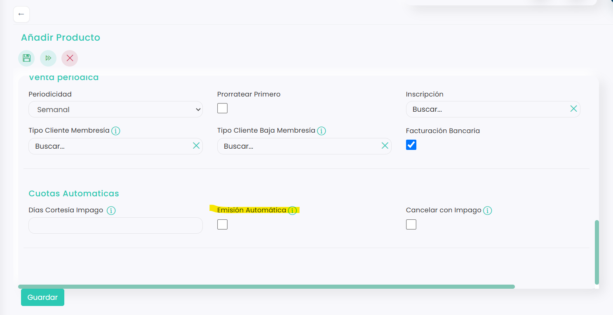

# Cómo automatizar la emisión de cuotas

Si activas la emisión automática en una cuota, ya no tienes que emitirla a mano cada mes desde el calendario de cuotas: el programa la emite sola.

> **Importante:** la cuota se emite automáticamente **el día siguiente a su vencimiento, a las 00:00**. Por ejemplo, si vence el día 1, se emite el día 2 a las 00:00.

A continuación, se detallan los pasos a seguir:



### Abrir la cuota

* Clica en el icono <i class="fa-gear" style="color:blue;">:gear:</i> de la esquina superior derecha y entra en **Configuración**.
* Clica en **Ventas**. Se abrirá directamente la pestaña **Productos**.
* En la columna **Categoría**, selecciona **Cuota** y clica en el **Id** de la cuota.
* Clica en el icono <i class="fa-pen">:pen:</i> para editarla.

> Si la cuota todavía no existe, puedes rellenar estos campos al crearla. Consulta [Cómo crear un producto tipo Cuota](../../../configuracion/configuracion/ventas/productos/como-crear-un-producto-tipo-cuota.md).



### Activar la emisión automática

*   En el bloque **Cuotas Automaticas**, marca **Emisión Automática**.

    <figure><figcaption></figcaption></figure>
* Clica en **Guardar**.



Al emitirse, la cuota queda pendiente de pago y el cliente la ve en su zona de clientes. Para cobrarla también de forma automática, consulta [Cómo activar el cobro automático con tarjeta](como-activar-el-cobro-automatico-con-tarjeta.md).
