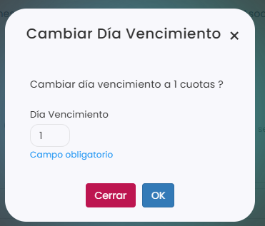

# Cómo cambiar el día de vencimiento de una cuota

El día de vencimiento es el día del mes en el que vence la cuota. Puedes cambiarlo en las cuotas que todavía no estén emitidas.

A continuación, se detallan los pasos a seguir:



### Acceso a las cuotas

* Dirígete al menú lateral izquierdo y selecciona **Ventas**.
* En el desplegable, elige **Cuotas**.
* Clica en el **Id** de la cuota.
* Entra en la pestaña **Calendario**.

> También puedes hacerlo desde la ficha del jugador o desde un grupo de academia. Para saber cómo, consulta este artículo:
>
> <a href="como-ver-las-cuotas.md" class="button primary">Cómo ver las cuotas</a>



### Seleccionar la cuota

* Marca el círculo de la cuota del mes que quieres cambiar, en la fila del jugador.
* Puedes marcar varias a la vez: el círculo junto al nombre de un jugador marca todas sus cuotas, y el círculo junto a un mes marca las de todos los jugadores en ese mes. La acción se aplicará a todas las que marques.
*   Clica en **Acciones**, arriba a la izquierda.

    <figure><figcaption></figcaption></figure>



### Cambiar el día

* En el menú de **Acciones**, elige **Cambiar Día Vencimiento**.
* En **Día Vencimiento**, escribe el día del mes. Este campo es obligatorio.
*   Clica en **OK** para guardar.

    <figure><figcaption></figcaption></figure>



> **Importante:** el cambio solo se aplica a las cuotas que hayas marcado. Si quieres cambiar el día de los meses siguientes, márcalos también.
