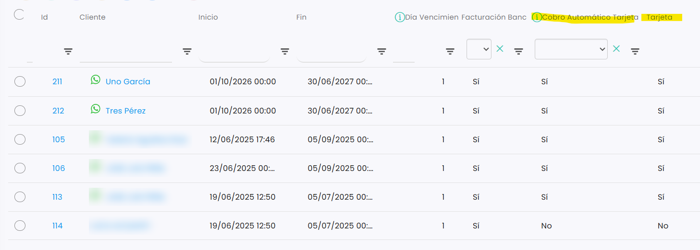

# Cómo dar de baja a un cliente de una cuota

Para dar de baja a un cliente de una cuota, o de una membresía, cambia su fecha de fin en la cuota. A partir de esa fecha dejan de emitirse sus recibos y, si la cuota es una membresía, pasa al tipo de cliente de baja.

A continuación, se detallan los pasos a seguir:



### Acceso a la cuota

* Dirígete al menú lateral izquierdo y selecciona **Ventas**.
* En el desplegable, elige **Cuotas**.
* Clica en el **Id** de la cuota.
* Entra en la pestaña **Jugadores**.



### Cambiar la fecha de fin

*   Localiza al jugador en el listado.

    <figure><figcaption></figcaption></figure>
* Edita su fecha de **Fin** y pon el día en que quieres que se dé de baja.



> **Importante:** solo cambia la fecha de ese jugador. El resto de jugadores de la cuota siguen igual.

Para saber más sobre las membresías, consulta [Qué es una membresía y cómo funciona](que-es-una-membresia-y-como-funciona.md).
