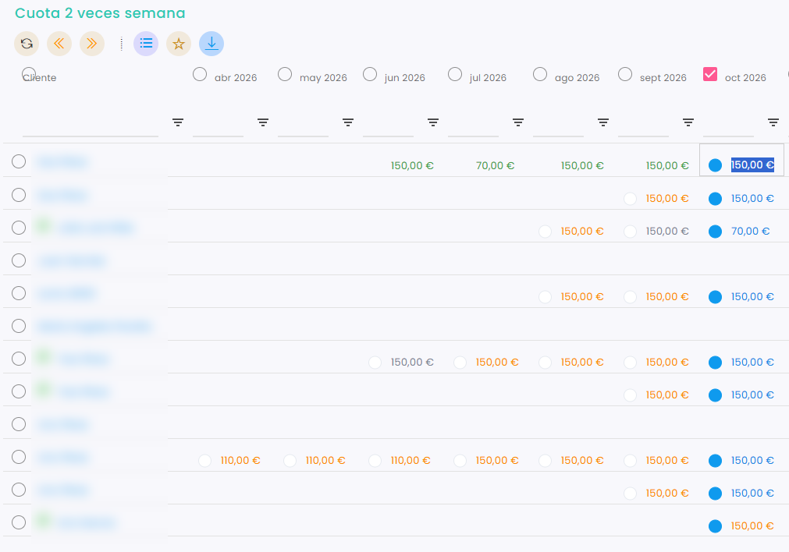
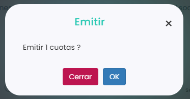

# Cómo emitir una cuota

Al emitir una cuota, el programa registra la deuda: se crea una línea de venta pendiente de pago y el cliente la ve en su zona de clientes, en sus ventas pendientes, para poder pagarla.

> **Importante:** si la cuota tiene activada la emisión automática, se emite sola y no hace falta hacerlo a mano. Se activa en la ficha de la cuota, en Configuración, con el check **Emisión Automática**, o para cada jugador, con el check de la lista de jugadores de la cuota. Para saber cómo crear la cuota, consulta este artículo:
>
> <a href="../../../configuracion/configuracion/ventas/productos/como-crear-un-producto-tipo-cuota.md" class="button primary">Cómo crear un producto tipo Cuota</a>

A continuación, se detallan los pasos a seguir:



### Acceso a las cuotas

* Dirígete al menú lateral izquierdo y selecciona **Ventas**.
* En el desplegable, elige **Cuotas**.
* Clica en el **Id** de la cuota.
* Entra en la pestaña **Calendario**.

> También puedes hacerlo desde la ficha del jugador o desde un grupo de academia. Para saber cómo, consulta este artículo:
>
> <a href="como-ver-las-cuotas.md" class="button primary">Cómo ver las cuotas</a>



### Seleccionar la cuota

* Marca el círculo de la cuota del mes que quieres cambiar, en la fila del jugador.
* Puedes marcar varias a la vez: el círculo junto al nombre de un jugador marca todas sus cuotas, y el círculo junto a un mes marca las de todos los jugadores en ese mes. La acción se aplicará a todas las que marques.
*   Clica en **Acciones**, arriba a la izquierda.

    <figure><figcaption></figcaption></figure>
* Por ejemplo, para emitir todas las cuotas de un mes, marca el círculo junto a ese mes:

    <figure><figcaption></figcaption></figure>



### Emitir

* En el menú de **Acciones**, elige **Emitir**.
*   Clica en **OK** para confirmar.

    <figure><figcaption></figcaption></figure>



Una vez emitida, la cuota solo se puede pagar o restablecer. Si necesitas cambiarla, primero restablécela. Para saber cómo, consulta este artículo:

<a href="como-restablecer-una-cuota.md" class="button primary">Cómo restablecer una cuota</a>
