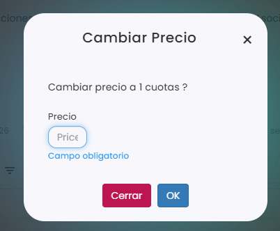

# Cómo modificar el precio de una cuota

Puedes cambiar el importe de una cuota concreta, por ejemplo para un mes en el que el alumno paga menos. El cambio solo afecta a las cuotas que marques, y solo se puede hacer si todavía no están emitidas.

A continuación, se detallan los pasos a seguir:



### Acceso a las cuotas

* Dirígete al menú lateral izquierdo y selecciona **Ventas**.
* En el desplegable, elige **Cuotas**.
* Clica en el **Id** de la cuota.
* Entra en la pestaña **Calendario**.

> También puedes hacerlo desde la ficha del jugador o desde un grupo de academia. Para saber cómo, consulta este artículo:
>
> <a href="como-ver-las-cuotas.md" class="button primary">Cómo ver las cuotas</a>



### Seleccionar la cuota

* Marca el círculo de la cuota del mes que quieres cambiar, en la fila del jugador.
* Puedes marcar varias a la vez: el círculo junto al nombre de un jugador marca todas sus cuotas, y el círculo junto a un mes marca las de todos los jugadores en ese mes. La acción se aplicará a todas las que marques.
*   Clica en **Acciones**, arriba a la izquierda.

    <figure><figcaption></figcaption></figure>



### Cambiar el precio

* En el menú de **Acciones**, elige **Modificar Precio**.
* En **Precio**, escribe el nuevo importe. Este campo es obligatorio.
*   Clica en **OK** para guardar.

    <figure><figcaption></figcaption></figure>



> **Importante:** si quieres que una persona o un tipo de jugador tenga siempre un precio distinto, es mejor usar los precios personalizados. Para saber cómo, consulta estos artículos:
>
> <a href="../../../configuracion/configuracion/ventas/personalizacion-de-precios/personalizar-precio-a-un-jugador-en-concreto.md" class="button primary">Personalizar precio a un jugador en concreto</a>
>
> <a href="../../../configuracion/configuracion/ventas/personalizacion-de-precios/personalizar-precios-por-tipo-de-jugador.md" class="button primary">Personalizar precios por tipo de jugador</a>
