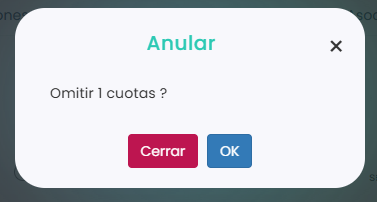

# Cómo omitir una cuota

Omitir una cuota sirve para que ese recibo no se cobre: no se genera el cargo ni entra en la remesa. Por ejemplo, si un alumno no viene un mes, en lugar de ponerle la cuota a 0 € puedes omitirla.

A continuación, se detallan los pasos a seguir:



### Acceso a las cuotas

* Dirígete al menú lateral izquierdo y selecciona **Ventas**.
* En el desplegable, elige **Cuotas**.
* Clica en el **Id** de la cuota.
* Entra en la pestaña **Calendario**.

> También puedes hacerlo desde la ficha del jugador o desde un grupo de academia. Para saber cómo, consulta este artículo:
>
> <a href="como-ver-las-cuotas.md" class="button primary">Cómo ver las cuotas</a>



### Seleccionar la cuota

* Marca el círculo de la cuota del mes que quieres omitir, en la fila del jugador.
* Puedes marcar varias a la vez: el círculo junto al nombre de un jugador marca todas sus cuotas, y el círculo junto a un mes marca las de todos los jugadores en ese mes. La acción se aplicará a todas las que marques.
*   Clica en **Acciones**, arriba a la izquierda.

    <figure><figcaption></figcaption></figure>



### Omitir

* En el menú de **Acciones**, elige **Omitir**.
*   Clica en **OK** para confirmar.

    <figure><figcaption></figcaption></figure>



La cuota omitida queda registrada y aparece en gris, tanto en el calendario de la cuota como en la ficha del jugador.

> **Importante:** solo se pueden omitir cuotas que no estén emitidas. Si ya está emitida, primero restablécela. Para saber cómo, consulta este artículo:
>
> <a href="como-restablecer-una-cuota.md" class="button primary">Cómo restablecer una cuota</a>
