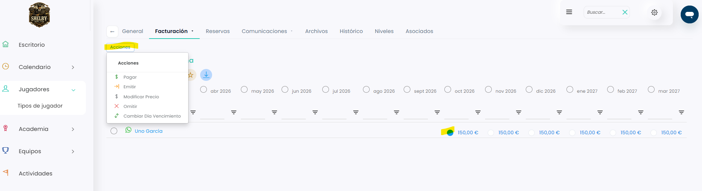
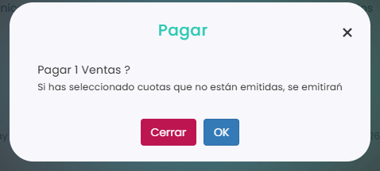

# Cómo pagar una cuota

Puedes cobrar una cuota desde el calendario de cuotas, esté emitida o no. Al pagarla, el programa te lleva al TPV para hacer el cobro como una venta normal.

A continuación, se detallan los pasos a seguir:



### Acceso a las cuotas

* Dirígete al menú lateral izquierdo y selecciona **Ventas**.
* En el desplegable, elige **Cuotas**.
* Clica en el **Id** de la cuota.
* Entra en la pestaña **Calendario**.

> También puedes hacerlo desde la ficha del jugador o desde un grupo de academia. Para saber cómo, consulta este artículo:
>
> <a href="como-ver-las-cuotas.md" class="button primary">Cómo ver las cuotas</a>



### Seleccionar la cuota

* Marca el círculo de la cuota del mes que quieres pagar, en la fila del jugador.
* Puedes marcar varias a la vez: el círculo junto al nombre de un jugador marca todas sus cuotas, y el círculo junto a un mes marca las de todos los jugadores en ese mes. La acción se aplicará a todas las que marques.
*   Clica en **Acciones**, arriba a la izquierda.

    <figure><figcaption></figcaption></figure>



### Pagar

* En el menú de **Acciones**, elige **Pagar**.
*   Clica en **OK** para confirmar.

    <figure><figcaption></figcaption></figure>

> **Importante:** si has seleccionado cuotas que todavía no están emitidas, se emitirán al pagarlas.



### Cobrar en el TPV

* Se abrirá el TPV con la cuota. Cobra con el método de pago que prefiera el cliente.


