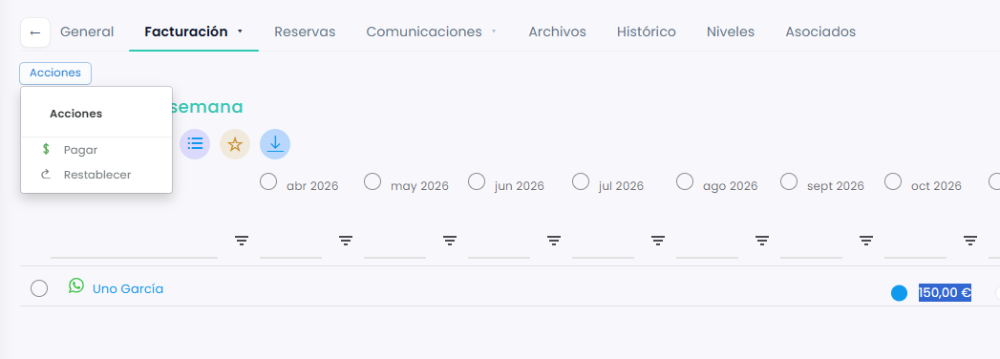
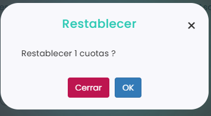

# Cómo restablecer una cuota

Restablecer una cuota deshace la emisión: la cuota vuelve a quedar como antes de emitirla. Es útil si la has emitido por error o si necesitas cambiar su precio, su día de vencimiento u omitirla, porque una cuota emitida solo se puede pagar o restablecer.

A continuación, se detallan los pasos a seguir:



### Acceso a las cuotas

* Dirígete al menú lateral izquierdo y selecciona **Ventas**.
* En el desplegable, elige **Cuotas**.
* Clica en el **Id** de la cuota.
* Entra en la pestaña **Calendario**.

> También puedes hacerlo desde la ficha del jugador o desde un grupo de academia. Para saber cómo, consulta este artículo:
>
> <a href="como-ver-las-cuotas.md" class="button primary">Cómo ver las cuotas</a>



### Seleccionar la cuota

* Marca el círculo de la cuota del mes que quieres cambiar, en la fila del jugador.
* Puedes marcar varias a la vez: el círculo junto al nombre de un jugador marca todas sus cuotas, y el círculo junto a un mes marca las de todos los jugadores en ese mes. La acción se aplicará a todas las que marques.
*   Clica en **Acciones**, arriba a la izquierda.

    <figure><figcaption></figcaption></figure>



### Restablecer

* En el menú de **Acciones**, elige **Restablecer**.
*   Clica en **OK** para confirmar.

    <figure><figcaption></figcaption></figure>



La línea de venta pendiente desaparece, tanto de Ventas › Líneas como de la zona de clientes del jugador. A partir de aquí, la cuota vuelve a tener todas las acciones disponibles: pagar, emitir, modificar el precio, omitir o cambiar el día de vencimiento.
