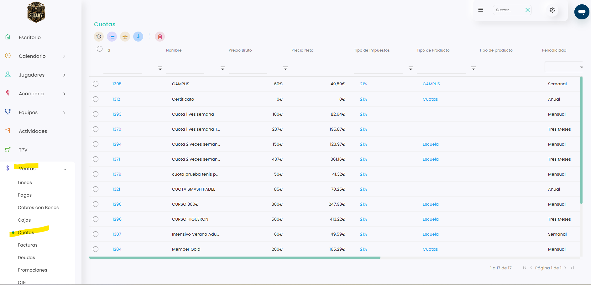
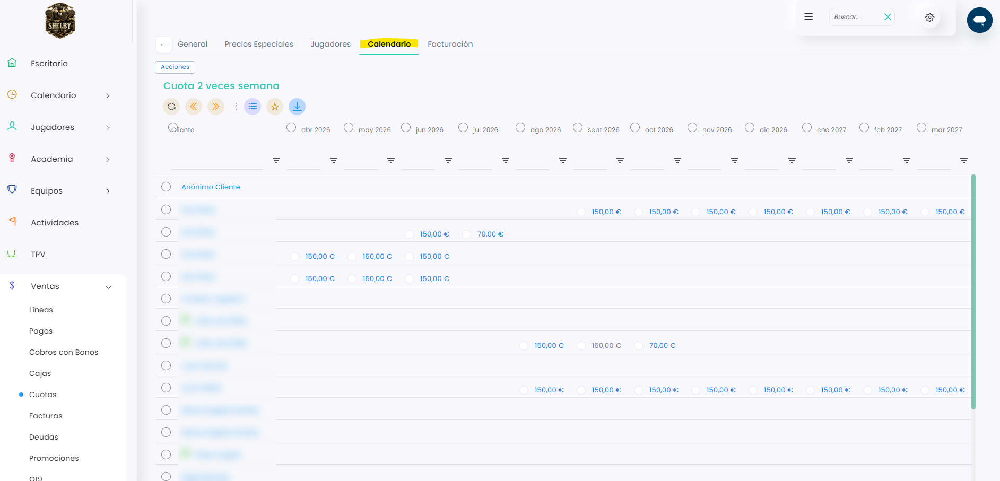
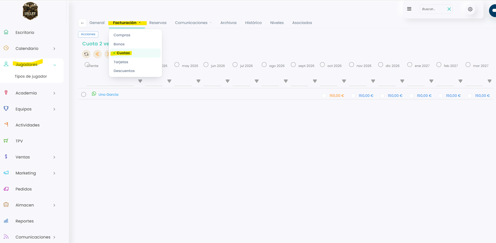
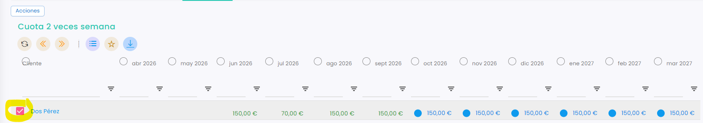

# Cómo ver las cuotas

Puedes consultar las cuotas de tres formas: por cuota, para ver a todas las personas que la tienen; por jugador, para ver todas las cuotas de una persona; o desde un grupo de academia.

## Desde Ventas: todas las personas con una cuota



### Acceso a Cuotas

*   Dirígete al menú lateral izquierdo, selecciona **Ventas** y, en el desplegable, elige **Cuotas**. Verás el listado de todas las cuotas del club.

    <figure><figcaption></figcaption></figure>



### Abrir el calendario de la cuota

* Clica en el **Id** de la cuota.
*   Entra en la pestaña **Calendario**. Verás una fila por cada persona que tiene esa cuota y una columna por cada mes, con el importe de cada recibo.

    <figure><figcaption></figcaption></figure>



## Desde la ficha del jugador: todas sus cuotas



### Acceso a la ficha

* Dirígete al menú lateral izquierdo y selecciona **Jugadores**.
* Busca al jugador y clica en su **Id**.



### Abrir sus cuotas

*   Clica en la pestaña **Facturación** y, en el desplegable, elige **Cuotas**. Verás todas las cuotas de ese jugador, mes a mes.

    <figure><figcaption></figcaption></figure>



## Desde un grupo de academia

Para ver las cuotas de los alumnos de un grupo, consulta este artículo:

<a href="../../../academia/academia/grupos-de-academia/cuotas.md" class="button primary">Cuotas</a>

## Qué puedes hacer con una cuota

Desde cualquiera de estas pantallas, marca el círculo de la cuota de un mes y clica en **Acciones**. Puedes marcar varias a la vez:

*   El círculo junto al nombre de un jugador marca todas sus cuotas.

    <figure><figcaption></figcaption></figure>
*   El círculo junto a un mes marca las de todos los jugadores en ese mes.

    <figure><figcaption></figcaption></figure>

Según el estado de la cuota, tendrás unas acciones u otras:

* Si la cuota **no está emitida**, puedes pagarla, emitirla, modificar su precio, omitirla o cambiar su día de vencimiento.
* Si la cuota **ya está emitida**, solo puedes pagarla o restablecerla.

## Qué significa cada color

* **Azul:** sin emitir.
* **Naranja:** emitida, pendiente de pago.
* **Verde:** pagada.
* **Gris:** omitida.
