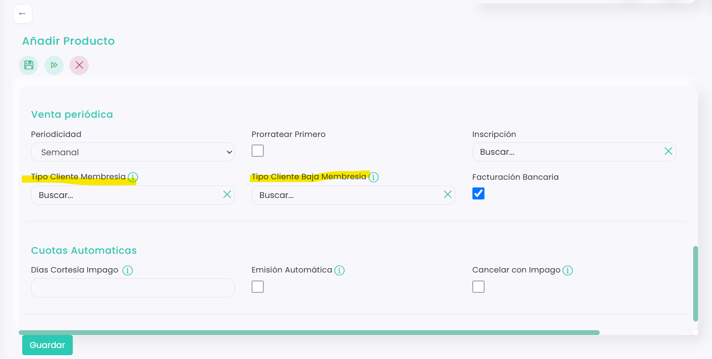

# Qué es una membresía y cómo funciona

Una membresía es una cuota que, además de cobrarse periódicamente, cambia el tipo de cliente de quien la tiene. Funciona como la cuota de un gimnasio: mientras el cliente la paga es **Socio** y disfruta de sus ventajas, como precios especiales, y cuando se da de baja vuelve a ser **No socio**.

## Cómo se convierte una cuota en membresía

En la ficha de la cuota, en el bloque **Venta periódica**, rellena estos dos campos:

<figure><figcaption></figcaption></figure>

* **Tipo Cliente Membresía:** el tipo de cliente que tendrá mientras esté en la cuota. Por ejemplo, **Socio**.
* **Tipo Cliente Baja Membresía:** el tipo de cliente que tendrá cuando se dé de baja. Por ejemplo, **No socio**.

Los tipos de cliente tienen que estar creados antes. Para saber cómo, consulta [Cómo crear diferentes tipos de jugadores](../../../jugadores/jugadores/fichas-de-jugador/como-crear-diferentes-tipos-de-jugadores.md). Para darles precios especiales, consulta [Personalizar precios por tipo de jugador](../../../configuracion/configuracion/ventas/personalizacion-de-precios/personalizar-precios-por-tipo-de-jugador.md).

Para saber dónde están estos campos, consulta [Cómo crear un producto tipo Cuota](../../../configuracion/configuracion/ventas/productos/como-crear-un-producto-tipo-cuota.md).

## Cómo entra un cliente en la membresía

* **Lo añade el club:** desde **Ventas › Cuotas**, en la pestaña **Jugadores** de la cuota, con **+**.
* **La contrata el propio cliente online:** si la cuota tiene marcada **Venta online**, puede comprarla desde la zona de clientes del club.

Al entrar, pasa automáticamente al **Tipo Cliente Membresía**.

## Cuándo deja de ser socio

El cliente pasa al **Tipo Cliente Baja Membresía** en cualquiera de estos casos:

* Cuando llega la fecha de **Fin** de su cuota.
* Cuando la cuota se cancela por impago. Consulta [Cómo automatizar la cancelación por impago](como-automatizar-la-cancelacion-por-impago.md).
* Cuando el club le da de baja de la cuota, cambiando su fecha de **Fin**. Consulta [Cómo dar de baja a un cliente de una cuota](como-dar-de-baja-a-un-cliente-de-una-cuota.md).
