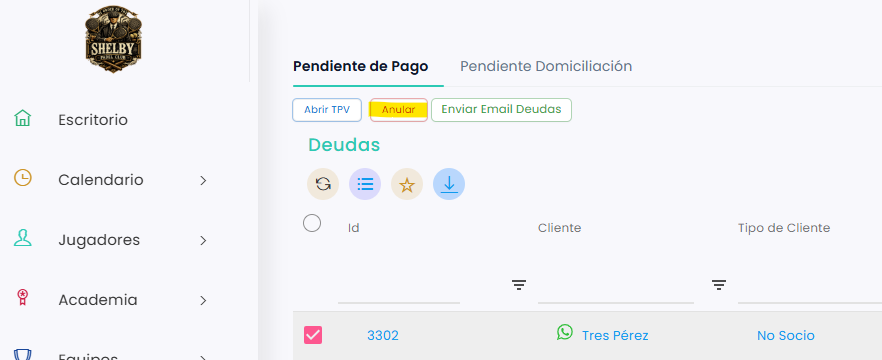
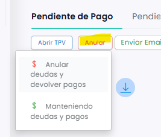
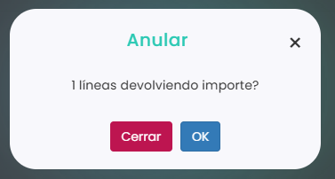

# Cómo anular una deuda

Si una deuda no se va a cobrar, puedes anularla desde **Ventas › Deudas** para que deje de aparecer como pendiente.

A continuación, se detallan los pasos a seguir:



### Acceso a Deudas

* Dirígete al menú lateral izquierdo y selecciona **Ventas**.
* En el desplegable, elige **Deudas**. Se abre la pestaña **Pendiente de Pago**.



### Seleccionar la deuda

* Marca la casilla de la izquierda de la deuda que quieres anular.
*   Clica en **Anular**. 

    <figure><figcaption></figcaption></figure>



### Elegir la opción de anular

*   Se abre un desplegable. Elige **Anular deudas y devolver pagos**. 

    <figure><figcaption></figcaption></figure>



### Confirmar

*   Se abre una ventana que te pide confirmación: 

    <figure><figcaption></figcaption></figure>
* Clica en **OK** para anularla, o en **Cerrar** si no quieres anularla.



> **Importante:** si al anular hay que devolver un pago en efectivo o con tarjeta, necesitas tener una caja abierta. Si es la devolución de un pago online, no hace falta. Para abrir una caja, consulta [Cómo abrir la caja](../cajas/como-abrir-la-caja.md).
